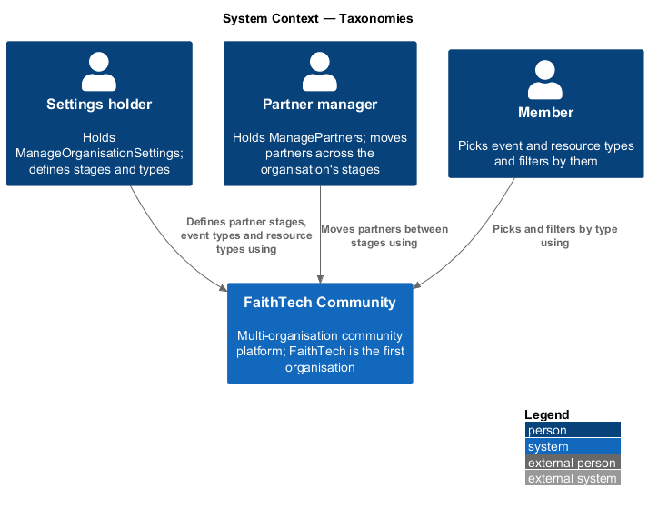
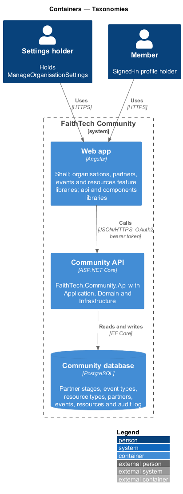
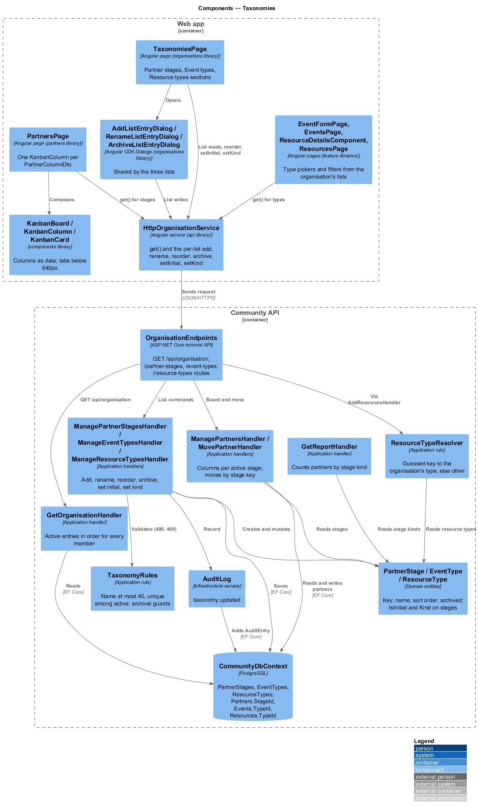
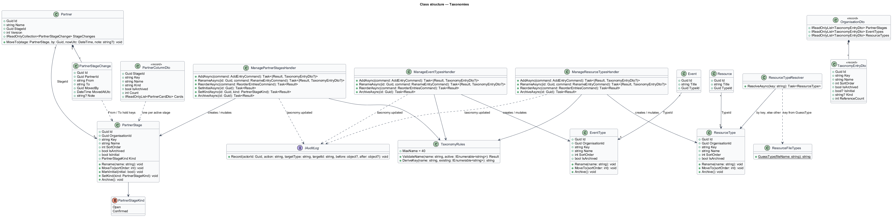
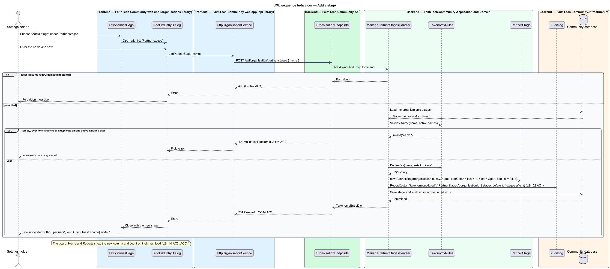
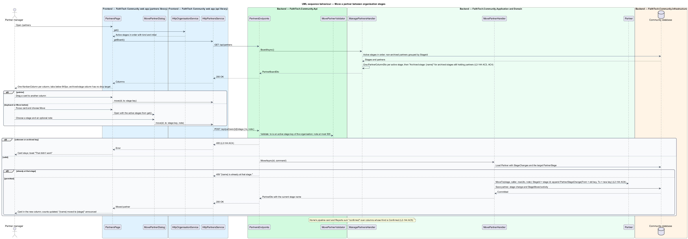
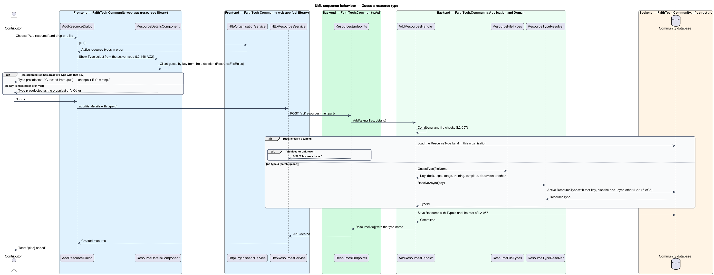

# Taxonomies

## Overview

A **taxonomy** — an ordered list an organisation defines for one field of the product, each entry with a stable key, a display name, a sort order and an archived flag. Three fields that are Domain enumerations today become taxonomies ([ADR 0035](../../../adr/0035-configurable-taxonomies.md)):

- **partner stage** — column of the partner pipeline; today the enumeration `PartnerStage` (`Lead`, `InFunnel`, `Confirmed`) in `Domain/Partners/`
- **event type** — kind of event; today the enumeration `EventType` (`Gathering`, `BuildersNight`, `Hackathon`, `PrayerAndPlanning`, `Panel`) in `Domain/Events/`
- **resource type** — kind of resource; today the enumeration `ResourceType` (`Deck`, `Logo`, `Image`, `Training`, `Template`, `Document`, `Other`) in `Domain/Resources/`

An **organisation** — tenant of the platform with its own members, roles, chapters, taxonomies, data and audit log (`organisations/tenancy-and-host-resolution`). A **key** — short stable identifier of an entry, used in URLs, in the partner stage history, in the resource type guess and in the seed, never shown to members. An **active entry** — entry that is not archived; only active entries appear in pickers, filters and columns. Entries are archived, never deleted, once referenced; a record that holds an archived entry keeps it and shows its name (seeded in FaithTech as the three lists above, with Lead as the initial stage and Confirmed as the one stage of kind Confirmed).

A partner stage carries two extra facts. **Initial stage** — the one active stage a new partner starts on. **Stage kind** — `Open` or `Confirmed`, so Home's pipeline card and the Reports "partners confirmed" figure count by kind rather than by name. Event types and resource types carry nothing extra, except that every organisation keeps a resource type keyed `other`, which cannot be archived, as the fallback for an upload whose guessed type the organisation does not have.

This design covers the three lists, the Stages & types settings page and its dialogs, the Kanban board rendering one column per active stage, the counting by stage kind, the event type picker and filter, the resource type picker and guess-by-key, the archival guards and the `GET /api/organisation` response that feeds every picker and filter. The page's tab shell and access rules are in `organisations/organisation-settings`; the partner board behaviour this design changes is in `partners/partner-kanban-board`; the resource dialogs are in `resources/add-and-edit`.

## Description

### Domain

- **`PartnerStage`** — becomes an entity in `Domain/Organisations/` with `Id`, `OrganisationId`, `Key`, `Name` (at most 40 characters, unique among active stages ignoring case), `SortOrder`, `IsArchived`, `IsInitial` and `Kind` (**`PartnerStageKind`**: `Open`, `Confirmed`). Methods `Rename`, `MoveTo(sortOrder)`, `MarkInitial`, `SetKind` and `Archive`. The organisation's stages satisfy two invariants: exactly one active stage is initial and at least one active stage exists (`L2-144` AC2).
- **`EventType`** and **`ResourceType`** — entities in `Domain/Organisations/` with `Id`, `OrganisationId`, `Key`, `Name` (at most 40 characters, unique among active ignoring case), `SortOrder` and `IsArchived`, with `Rename`, `MoveTo` and `Archive`. The `ResourceType` keyed `other` refuses `Archive` (`L2-146` AC1).
- **`Partner.StageId`** — reference to a `PartnerStage` replacing the enumeration value `Partner.Stage` (mapped today as a 16-character string with the index `IX_Partners_Stage`). `Partner.MoveTo(stage: PartnerStage, by, nowUtc, note)` refuses an archived stage and the current stage, and appends a **`PartnerStageChange`** whose `From` and `To` hold the stage keys (`L2-144` AC6), so history survives a rename and the merge of ADR 0028 compares keys. `PartnerActivity.FromStage` and `ToStage` hold keys likewise.
- **`Event.TypeId`** — reference to an `EventType` replacing `Event.Type`. **`Resource.TypeId`** — reference to a `ResourceType` replacing `Resource.Type`.

### Application

- **`GetOrganisationHandler`** — `GET /api/organisation` returns, for every member, **`OrganisationDto`** with `PartnerStages` (`TaxonomyEntryDto` `Id`, `Key`, `Name`, plus `IsInitial` and `Kind` on stages), `EventTypes` and `ResourceTypes`, each the active entries in order. Pickers and filters read this response; archived entries are not in it (`organisations/chapters` describes the chapter part of the same response).
- **`ListTaxonomyHandler`** — `GET /api/organisation/partner-stages`, `/event-types` and `/resource-types` for the settings page, readable with `ManageOrganisationSettings` or `ManageRoles` as the other settings tabs are (`L2-147` AC2). `?archived=true` lists the archived entries, otherwise the active ones in order, each with its reference count (`PartnerCount`, `EventCount`, `ResourceCount`) (`L2-144` AC1, `L2-145` AC1, `L2-146` AC1). For partner stages it is `ManagePartnerStagesHandler.ListAsync`, answering **`PartnerStageDto`** (`Id`, `Key`, `Name`, `SortOrder`, `IsInitial`, `Kind`, `Archived`, `ArchivedAtUtc`, `PartnerCount`).
- **`ManagePartnerStagesHandler`**, **`ManageEventTypesHandler`**, **`ManageResourceTypesHandler`** — `AddAsync`, `UpdateAsync`, `ReorderAsync` and `ArchiveAsync` in `Application/Organisations/`. For stages, `UpdateAsync` takes **`PartnerStageCommand`** (`Name`, `IsInitial`, `Kind`, each optional) at `PUT /api/organisation/partner-stages/{id}`: the rename dialog sends the name, and the row menu sends `isInitial: true` or a kind. `PUT /order` takes every active id once (`400` "List every active stage once." otherwise). Each requires `ManageOrganisationSettings` (`403`), applies **`TaxonomyRules`** (trimmed name required, at most 40 characters, unique among active entries ignoring case; a violation answers `400` with problem details), derives a new entry's key from its name (lower-cased, non-alphanumerics replaced by `-`, made unique with a numeric suffix) and writes `taxonomy.updated` through `IAuditLog` with the list name and the before and after values in the same unit of work (`L2-152` AC1). Keys never change after creation.
- **Archival guards** — `ArchiveAsync` on a stage checks, in this order: `409` "{n} partners are on this stage. Move them first." ("1 partner is on this stage. Move it first.") while any non-archived partner holds it (`L2-144` AC7); `409` "Keep at least one stage. Add another stage first." for the last active stage; and `409` "Choose another initial stage first." while it is initial. Setting the initial stage moves the flag in one save so exactly one active stage stays initial; archiving the last active stage or the last active event type is refused with `409` (`L2-144` AC2, `L2-145` AC2); archiving the resource type keyed `other` is refused with `409` (`L2-146` AC1). Event types and resource types with references may be archived: the records keep the entry and show its name (`L2-145` AC4, `L2-146` AC4).
- **`PartnerDto`** — `Stage` carries the stage key, with `StageName` (the current name, "{name} (archived)" once archived) and `StageKind`. The timeline writes "Added {name} as a {initial stage, lower-cased}", "Added {name} at {stage}" and "Moved {name} from {stage} to {stage}" with the current names (`L2-144` AC6). Search shows the stage name as the partner's badge.
- **`ManagePartnersHandler.BoardAsync`** — builds **`PartnerBoardDto`** with one **`PartnerColumnDto`** (`Stage` (the key), `StageId`, `Name`, `Kind`, `Archived`, `Count`, `Cards`) per active stage in order, then one "Archived stage: {name}" column per archived stage that still holds non-archived partners, at the end (`L2-144` AC3, AC4). `CreateAsync` puts a new partner on the initial stage, or on the active stage whose key `Stage` names; an unknown or archived key answers `400` "Choose a stage from the list." keyed `Stage`.
- **`MovePartnerValidator`** / **`MovePartnerHandler`** — `MovePartnerCommand.To` carries a stage key; an unknown or archived key answers `400` "Choose a stage from the list." keyed `To` (`L2-144` AC4); the current stage answers `409` as today.
- **`GetReportHandler`** — the "partners confirmed" figure counts non-archived partners whose stage `Kind` is `Confirmed`; **`PartnerPipelineRowDto`** (`Chapter`, `Counts`) carries one count per active stage, in the order of **`ReportDto.Stages`** (the active stage names, which head the table and the CSV), in place of the fixed `Lead`, `InFunnel` and `Confirmed` columns (`L2-144` AC5, ADR 0030).
- **`ListEventsHandler`** — `ListEventsQuery.Filter` loses `Hackathons`; the query gains `Type` (an event type key). **`EventListDto`** loses its fixed chips; `EventSummaryDto.Type` becomes `TypeName`. `SaveEventHandler` takes `TypeId`, refuses an archived type on create (`400`) and keeps an event's current archived type on edit.
- **`ResourceFileTypes.GuessType`** — returns a type key (`deck`, `logo`, `image`, `training`, `template`, `document`, `other`) in place of a `ResourceType` value. **`ResourceTypeResolver`** — `Resolve(key)` returns the organisation's active `ResourceType` with that key, or the entry keyed `other` when the key is missing or archived (`L2-146` AC3). `AddResourcesHandler`, `AddLinkHandler` and `EditResourceHandler` accept a `TypeId` from the details or resolve the guess; an archived type on a new resource answers `400`, and a resource's current archived type is kept on edit (`L2-146` AC2). `ListResourcesHandler` filters by `TypeId` and lists archived types under their own name only when `includeArchivedTypes` is set (`L2-146` AC4).

### Infrastructure

- **`CommunityDbContext`** — maps `PartnerStages`, `EventTypes` and `ResourceTypes` (`Key` and `Name` `HasMaxLength(40)`, unique index on `OrganisationId` and `Key`, unique index on `OrganisationId` and the lower-cased name among active rows), `Partners.StageId` with `IX_Partners_StageId` in place of `IX_Partners_Stage`, `Events.TypeId` and `Resources.TypeId`. `PartnerStageChanges.From` and `To` and `PartnerActivities.FromStage` and `ToStage` become 40-character keys.
- **`TaxonomiesFromEnumerations`** — EF Core migration applied by the Cli: seeds the FaithTech lists with the keys `lead`, `in-funnel`, `confirmed`; `gathering`, `builders-night`, `hackathon`, `prayer-and-planning`, `panel`; `deck`, `logo`, `image`, `training`, `template`, `document`, `other`; maps every enumeration value to its entry; rewrites history strings to keys; then drops the string columns. Running it again changes nothing.
- **`CommunitySeeder`** — seeds the same lists idempotently for a fresh database (`organisations/seed-faithtech`).

### Web app

- **`TaxonomiesPage`** — tab of `OrganisationPage` in the `organisations` feature library at `/organisation/taxonomies`, with three sections "Partner stages", "Event types" and "Resource types". Each is a `ReorderableListComponent` of the active entries in order with its count ("{n} partners", "{n} events", "{n} resources"), reorder by drag and keyboard (the `L2-089` pattern), an "Archived" filter and a row menu (`MenuComponent`) with Rename and Archive. Stage rows also show the badges "Initial" (info) and their kind ("Open", or "Confirmed" in success), and the menu adds "Set as initial" (disabled on the initial stage) and the "Counts as" Open / Confirmed choices (`menuitemradio`), which call the API directly; "Set as initial" confirms with a toast. The partner-stages slice ships the page with its "Partner stages" section; the event-types and resource-types slices add theirs. Holders of only `ManageRoles` see the sections read-only (`L2-147` AC2).
- **`ListEntryNameDialog`** (add and rename) and **`ArchiveListEntryDialog`** — CDK dialogs in the `organisations` library shared by the three lists, taking the heading, copy and the save or archive call as data: one `ft-text-field` with the counter "{n} / 40" and the inline error from a `400`; archive confirms what keeps the entry and shows "Can’t archive {name}" with the `409` message when the guard refuses ("{n} partners are on this stage. Move them first."), with "Open the partner board" and Close; a stage's known partner count shows that refusal before any request. A failed save keeps the dialog open and offers "Try again" (`L2-147` AC5).
- **`OrganisationService`** / **`ORGANISATION_SERVICE`** / **`HttpOrganisationService`** — `get()` plus, per list, `listPartnerStages(archived?)`, `addPartnerStage(name)`, `updatePartnerStage(id, change)` (a name, `isInitial: true` or a kind), `reorderPartnerStages(ids)` and `archivePartnerStage(id)`, and the same shape for event types and resource types.
- **Partner board** — `PartnersPage` renders one `KanbanColumnComponent` per `PartnerColumnDto`, so the columns follow the organisation's stages; `KanbanBoardComponent` turns them into tabs below the 640px `sm` breakpoint as today (`L2-144` AC3). The archived-stage column renders with the title "Archived stage: {name}" and no drop target (`KanbanColumnComponent.droppable` false), and goes once its last partner moves (`L2-144` AC4). `MovePartnerDialog` lists the active stages from `OrganisationService.get()` and sends the key. The `components` library's Kanban column takes its title and stage as data and knows no stage name.
- **Home** — `HomePage` reads `PartnersService.getBoard()` as today and shows one count per active column (`L2-144` AC5); its skeleton names the organisation's stages from `OrganisationService.get()` until the counts arrive.
- **Events** — `EventsPage` replaces the fixed "Hackathons" chip with an `ft-select` "All types" plus the active types; `type=` carries the key (`L2-145` AC3). `EventFormPage` offers the active types in order plus the event's current archived type (`L2-145` AC2). `EVENT_TYPE_LABELS` in the `api` library is removed; type names come from the DTOs.
- **Resources** — `ResourceDetailsComponent` offers the active resource types plus the resource's current archived type, and `ResourceFileRules` on the client mirrors the key guess for the hint "Guessed from .{ext} — change it if it’s wrong." (`L2-146` AC2, AC3). `ResourcesPage` gains "Show archived types" on its type filter (`L2-146` AC4).

### E2E fake

`mock-api.ts` holds the three FaithTech lists as data, answers `GET /api/organisation` and the taxonomy routes, builds board columns from the stages and resolves a guessed resource type by key, so the specs for partners, events and resources run against the same contract.

## Requirements

The feature realizes the following level-2 (L2) requirements. Each L2 requirement refines a level-1 (L1) requirement, cited by identifier.

| L2 ID | Refines (L1) | Requirement |
|-------|--------------|-------------|
| `L2-144` | `L1-028`, `L1-006` | Partner stages |
| `L2-145` | `L1-028`, `L1-008` | Event types |
| `L2-146` | `L1-028`, `L1-020` | Resource types |

### Acceptance criteria

**`L2-144` — Partner stages**

1. Given a holder of `ManageOrganisationSettings` on Stages & types (`/organisation/taxonomies`), when they view "Partner stages", then it lists the active stages in order with their partner counts, which is the initial stage, and each stage's kind (Open or Confirmed), and offers add, rename, reorder, set as initial, set kind and archive; the writes are under `/api/organisation/partner-stages` and audited under `taxonomies`.
2. Given the stages, when they are saved, then exactly one active stage is initial, at least one active stage exists, and a name is required, up to 40 characters and unique among active stages ignoring case; a violation answers 400 with an inline error.
3. Given the Kanban board (`L2-018`), when it renders, then it shows one column per active stage in order (tabs on XS) with that stage's partners, and a new partner (`L2-017` AC1) starts on the initial stage.
4. Given a partner on an archived stage, when the board renders, then it is listed in an "Archived stage: {name}" column at the end until moved; moving a partner onto an archived stage is refused with 400.
5. Given Home's pipeline card (`L2-049` AC6) and Reports' "partners confirmed" (`L2-125`), when they count, then they count partners whose stage kind is Confirmed, and show one count per active stage.
6. Given the stage history, merge dialog and timeline "Stage moves" (`L2-017`, `L2-111`, `L2-114`), when a stage is renamed, then history shows the current name; when archived, then history shows the name with "(archived)".
7. Given a stage with partners, when it is archived, then the request is refused with 409 "{n} partners are on this stage. Move them first." (an archived stage keeps no partners).

**`L2-145` — Event types**

1. Given a holder of `ManageOrganisationSettings` on Stages & types, when they view "Event types", then it lists the active types in order with their event counts and offers add, rename, reorder and archive under `/api/organisation/event-types`, audited under `taxonomies`; a name is required, up to 40 characters and unique among active types ignoring case.
2. Given the event form (`L2-020` AC1), when it renders, then "Type" offers the active types in order, plus the event's current type if archived, and at least one active type must exist for an event to be created.
3. Given the event list (`L2-021`), when it renders, then its type filter offers "All types" and the active types in place of the former fixed filter chips; the `type=` query carries the type key.
4. Given an event of an archived type, when it is shown, then the type name is shown as before; the type leaves the form's picker and the filter.
5. Given `.ics` export and the public event page, when they render, then the type name appears where it did before.

**`L2-146` — Resource types**

1. Given a holder of `ManageOrganisationSettings` on Stages & types, when they view "Resource types", then it lists the active types in order with their resource counts and offers add, rename, reorder and archive under `/api/organisation/resource-types`, audited under `taxonomies`; a name is required, up to 40 characters and unique among active types ignoring case; the type keyed `other` cannot be archived.
2. Given the add and edit resource dialogs (`L2-055`, `L2-059`), when they render, then "Type" offers the active types in order, plus the resource's current type if archived.
3. Given an upload, when its type is guessed from the extension (`L2-055` AC5), then the guess maps by key (`deck`, `logo`, `image`, `training`, `template`, `document`) to the organisation's active type with that key, or to `other` when that key is missing or archived.
4. Given the Resources page filter (`L2-058`), when it renders, then it offers the active types; resources of an archived type are listed under "All types" and under their own name when "Show archived types" is chosen.

## Diagrams

### System context

A settings holder defines the lists; leads move partners across the organisation's stages; members pick event and resource types and filter by them. No external system takes part.

### Containers

The `organisations`, `partners`, `events` and `resources` feature libraries read the lists from the Community API through the `api` library. The API persists the lists and the references on partners, events and resources in the PostgreSQL Community database.

### Components

`GetOrganisationHandler` feeds every picker; the three manage handlers change the lists under `TaxonomyRules` and the archival guards; `ManagePartnersHandler.BoardAsync` builds columns from the stages; `ResourceTypeResolver` maps a guessed key onto the organisation's list.

### Class structure

`PartnerStage`, `EventType` and `ResourceType` are per-organisation entries; `Partner`, `Event` and `Resource` reference them by id, and `PartnerStageChange` records stage keys.

### Behaviour — add a stage

The dialog posts the name; the handler requires `ManageOrganisationSettings`, applies `TaxonomyRules`, derives the key, appends the stage as `Open` and not initial, and audits `taxonomy.updated` in the same unit of work (`L2-144` AC1, AC2).

### Behaviour — move a partner between organisation stages

The board shows one column per active stage plus an archived-stage column; a move sends the target key, which the validator checks against the active stages, and `Partner.MoveTo` records keys in the history (`L2-144` AC3, AC4, AC6).

### Behaviour — guess a resource type

`ResourceFileTypes.GuessType` yields a key from the extension and `ResourceTypeResolver` maps it onto the organisation's active types, falling back to `other` (`L2-146` AC3).

## Open questions

Decisions recorded for this design ([ADR 0035](../../../adr/0035-configurable-taxonomies.md)):

- Lists are ordered entries with stable keys, archived and never deleted; nothing in `components` knows a stage or type name. Resolved.
- Partners reference the live stage by id and record keys in history, so renames show the current name and archived stages show "(archived)". Resolved.
- A stage with partners cannot be archived; event and resource types with references can, and the records keep them. Resolved.
- "Set as initial" and "Counts as" are row-menu actions that call `PUT /api/organisation/partner-stages/{id}` rather than open a dialog, as the Stages & types row-menu mock shows. Resolved.
- FaithTech's second stage is named "In Funnel", as `L2-151` and the mocks write it. Resolved.
- Key derivation from a name (lower-cased, `-` for runs of non-alphanumerics, numeric suffix on collision) is proposed here; the seeded keys are fixed by the migration.
- Whether the Resources page "Show archived types" is a checkbox beside the type filter or an option inside it: `<TO SUPPLY>` from the mock.
