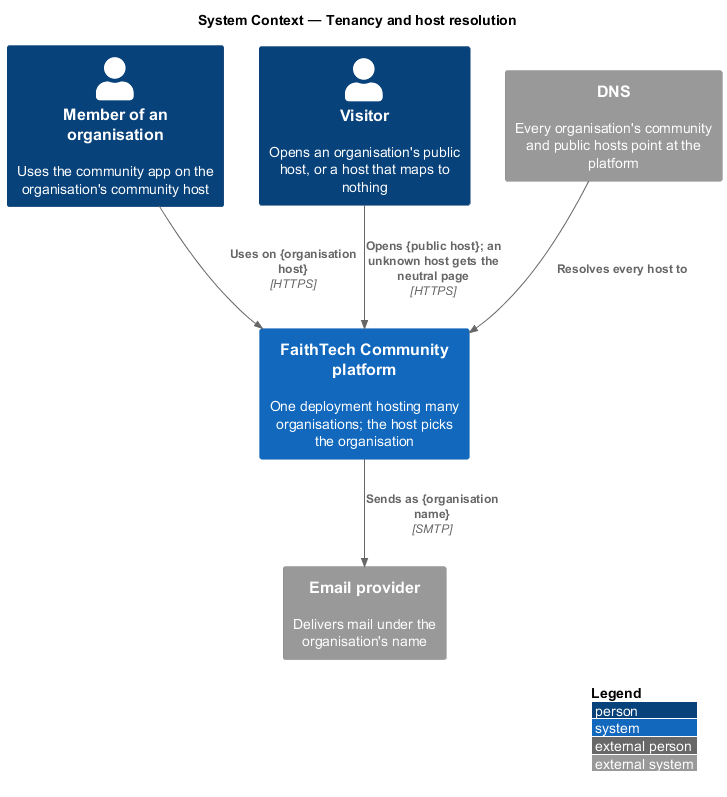
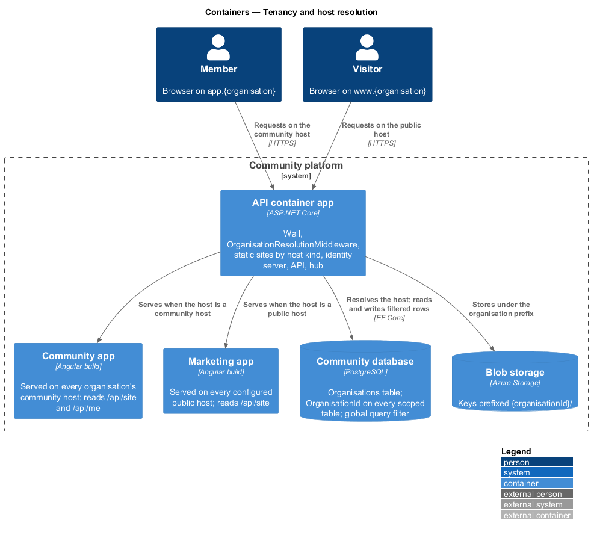
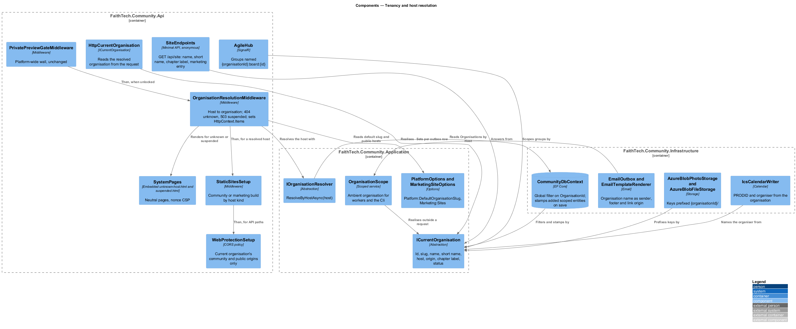
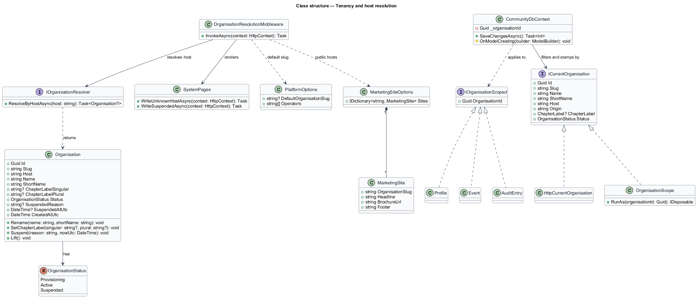
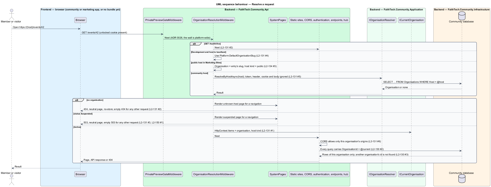
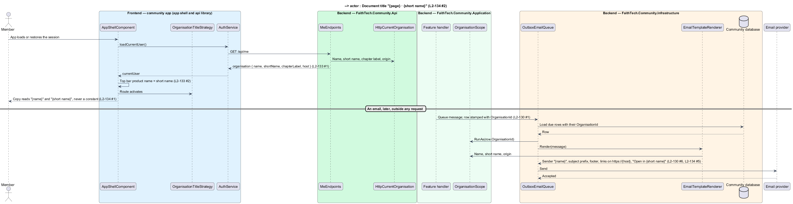

# Tenancy and host resolution

## Overview

FaithTech Community was built for one organisation: every table is global, "FaithTech" is in the copy and the email footer, and one host serves the app (ADR 0018, ADR 0026). The organisations subsystem makes the product a platform: one deployment hosts many organisations, and FaithTech is the first one, provisioned by seed so that nothing it does today changes (`docs/proposals/organisations.md`, ADR 0032). This design covers the foundation the rest of the subsystem stands on: the organisation record, how a request finds its organisation, and how every record, query, file, message and audit entry stays inside it.

- **organisation** — tenant of the platform: a named community with its own host, members, roles, chapters, taxonomies, data and audit log
- **slug** — short lower-case identifier of an organisation, 3 to 40 letters, digits and hyphens, unique across the platform
- **community host** — host name that serves an organisation's community app, API and identity server, for example `app.faithtech.community`; unique across the platform
- **public host** — host name that serves an organisation's marketing page, for example `www.faithtech.community`; configured per host, with FaithTech's as the default
- **scoped record** — aggregate root other than accounts, external logins and the identity server's own tables; it carries an `OrganisationId` and is visible only inside that organisation
- **current organisation** — organisation the request host resolves to, exposed to the rest of the request as `ICurrentOrganisation`
- **neutral page** — server-rendered page that names no organisation and no product, in the manner of the private-preview wall page: the unknown-host page (404) and the suspended page (503)

The host decides the organisation, nothing else does. A token, a header, a cookie, a query string or a body that names an organisation is ignored (`L2-131` AC5). Accounts are global and are not scoped; a member's profile is their membership of one organisation (`docs/detailed-designs/organisations/accounts-and-memberships`). Provisioning, suspension and the platform operators are in `docs/detailed-designs/organisations/platform-operations`. The private-preview wall stays platform-wide: one passphrase, one cookie domain, in front of every host (ADR 0026).

## Description

### Domain — `Organisations/`

- **`Organisation`** — aggregate root in `FaithTech.Community.Domain/Organisations/`. Fields: `Id`, `Slug`, `Host` (the community host), `Name` (up to 100 characters), `ShortName` (up to 30 characters), `ChapterLabelSingular` and `ChapterLabelPlural` (both null when the organisation has no chapters, ADR 0034), `Status`, `SuspendedReason`, `SuspendedAtUtc` and `CreatedAtUtc`. Methods: `Rename(name, shortName)` and `SetChapterLabel(singular, plural)` (used by the organisation settings design), `Suspend(reason, nowUtc)` and `Lift()` (used by platform operations). `Suspend` on a suspended organisation and `Lift` on an active one throw, as `Profile.Suspend` and `Profile.Reinstate` do today.
- **`OrganisationStatus`** — enumeration `Provisioning`, `Active`, `Suspended`. `Provisioning` is held only while `ProvisionOrganisationHandler` writes the organisation's defaults in one unit of work; a request never sees it.
- **`IOrganisationScoped`** — interface with one property, `Guid OrganisationId`, implemented by every scoped aggregate root: `Profile`, `Invite`, `ConnectLink`, `Contact`, `Partner`, `Event`, `Announcement`, `Notification`, `Resource`, `NotePage`, `Workspace`, `WorkItem`, `AuditEntry`, the outbox email, `RoleDefinition`, `Chapter`, the three taxonomy lists and `OrganisationAdminRoster`. Child entities (photos, RSVPs, blocks, comments) reach their organisation through their parent and are not stamped.

### Application — `Organisations/`

- **`ICurrentOrganisation`** — abstraction in `FaithTech.Community.Application/Organisations/` exposing `Id`, `Slug`, `Name`, `ShortName`, `Host`, `Origin` (`https://{Host}`; in Development, `WebApp:Origin` stands in for the default organisation so that email links keep working on `localhost`), `ChapterLabel` (singular and plural, or null) and `Status`. Handlers read it the way they read `ICurrentUser` today. Every handler that composes copy, an email, an `.ics` file or a link reads the name, short name and origin from it, never from a constant (`L2-134`).
- **`IOrganisationResolver`** — `ResolveByHostAsync(host)` returns the organisation whose `Host` equals the request host, case-insensitively, or null. Infrastructure implements it over the unique `Host` index with one indexed query per request. A cache is deferred, because a suspension shall take effect on the next request (`L2-150` AC1).
- **`OrganisationScope`** — scoped service holding the ambient organisation for code that runs outside an HTTP request: the Cli `org` commands, the email outbox, the storage retry worker and the resource purge worker. `RunAs(organisationId)` sets it for the current scope; the workers set it per row from the row's `OrganisationId`. `HttpCurrentOrganisation` reads the request; `OrganisationScope` is what the workers and the Cli provide as `ICurrentOrganisation` instead.
- **`PlatformOptions`** — section `Platform`: `DefaultOrganisationSlug` (Development only: the organisation that `localhost` resolves to, `L2-131` AC4) and `Operators` (platform operations). The API validates on start that the slug is well-formed when it is set.
- **`MarketingSiteOptions`** — section `Marketing:Sites`, one entry per public host: `OrganisationSlug`, `Headline`, `BrochureUrl` and `Footer`. `Marketing:Origin` keeps its meaning as FaithTech's public host and is the default entry. A public host with no entry is an unknown host (`L2-134` AC3).

### Infrastructure — `Persistence/`, `Storage/`, `Search/`, `Email/`, `Calendar/`, `Admin/`

- **Global query filter** — `CommunityDbContext` takes `ICurrentOrganisation` through its constructor and, in `OnModelCreating`, applies `HasQueryFilter(e => e.OrganisationId == _organisationId)` to every `IOrganisationScoped` entity, composed with the existing archived filter where one exists (`Workspace`, `WorkItem`), because EF Core keeps one filter expression per entity. Every list, search, export, notification, SignalR group, report and load by id therefore runs its organisation predicate in SQL (`L2-130` AC2), and an id from another organisation is not found, which the `NotFoundOrForbidden` convention already turns into 404 (`L2-130` AC3, `L2-042` AC2). `IgnoreQueryFilters()` is used only where the archived filter is lifted today, and those queries add the organisation predicate by hand.
- **Stamping on save** — `CommunityDbContext.SaveChangesAsync` sets `OrganisationId` on every added `IOrganisationScoped` entity from `ICurrentOrganisation` and throws when an entity arrives with a different value, so no request can set another organisation (`L2-130` AC1). `OrganisationId` has no public setter in the Domain.
- **Unique indexes** — every unique index starts with `OrganisationId`: profile per account (`Profiles (OrganisationId, UserId)`), connect link per owner, one pending connection, chapter name, role definition name, taxonomy keys and the rest that are unique today (`L2-130` AC4). `Organisations.Slug` and `Organisations.Host` are unique across the platform.
- **Blob paths** — `AzureBlobPhotoStorage` and `AzureBlobFileStorage` prefix every key with `{organisationId}/`. A photo or file URL is issued by the API on the organisation's host for a record found through the filtered context, so a file is reachable only through its own organisation (`L2-130` AC5).
- **Search** — `PostgresFullTextSearch` queries the filtered DbSets, so the organisation predicate joins the permission filters in the same SQL.
- **SignalR** — `AgileHub.BoardGroup` and `PokerGroup` names start with the organisation id (`{organisationId}:board:{workspaceId}`), and a connection joins a group only after the workspace or session is found through the filtered context.
- **Email** — the outbox row carries `OrganisationId`; `OutboxEmailQueue` sets `OrganisationScope` from it before `EmailTemplateRenderer` runs. The sender display name is the organisation's name over the platform's `Smtp:From` address, the subject prefix and the footer carry the name, the action button reads "Open in {short name}" instead of the constant `ActionLabel`, and every link, the unsubscribe link included, is built on `ICurrentOrganisation.Origin` (`L2-130` AC6, `L2-134` AC5).
- **`.ics`** — `IcsCalendarWriter` writes `PRODID:-//{organisation name}//Events//EN` and the organisation's name as the organiser (`L2-134` AC4).
- **Audit** — `AuditEntry` implements `IOrganisationScoped`; `AuditLog.Record` stamps it like every other row, and the audit page lists only the current organisation's entries (`L2-130` AC7). Platform operator actions never reach this log (`L2-152` AC4).
- **Migration** — adds `Organisations`, seeds the FaithTech row, adds `OrganisationId` to every scoped table backfilled to FaithTech, recreates the unique indexes with the organisation prefix, and moves the account link from `AspNetUsers.ProfileId` to `Profiles.UserId` (ADR 0032).

### Api — `Middleware/Organisations/`

- **`OrganisationResolutionMiddleware`** — added in `Program.cs` after `app.UsePrivatePreview()`, `app.UseExceptionHandler()` and `app.UseStatusCodePages()`, and before `app.UseStaticSites`, `app.UseCors`, `app.UseAuthentication` and routing, so an unresolved host reaches no static file, no endpoint, no hub and no identity endpoint (`L2-131` AC1). It:
  - passes `GET /health/live` through, as the wall does (`L2-131` AC2);
  - in Development, treats `localhost` as the organisation named by `Platform:DefaultOrganisationSlug` (`L2-131` AC4);
  - looks the host up as a public host in `Marketing:Sites`, then as a community host through `IOrganisationResolver`;
  - for no match, answers 404: the unknown-host page for a navigation (`GET` or `HEAD` accepting `text/html`), an empty body for anything else, with `Cache-Control: no-store`; nothing is logged beyond the request log (`L2-131` AC2);
  - for a suspended organisation, answers 503 in the same two forms with the suspended page (`L2-131` AC3, `L2-150` AC1);
  - otherwise stores the organisation and the host kind (community or public) in `HttpContext.Items` and calls the next middleware.
- **`HttpCurrentOrganisation`** — realises `ICurrentOrganisation` from `HttpContext.Items`, as `HttpCurrentUser` realises `ICurrentUser`.
- **`SystemPages`** — renders `unknown-host.html` and `suspended.html`, embedded resources that follow `WallPage`: the design system's auth layout and card rules inline under the neutral accent, a per-response CSP nonce, no app bundle and no product name (ADR 0026 records why these pages are not Angular). The e2e fake renders the same files.
- **CORS** — `WebProtectionSetup` replaces the fixed origin list with `SetIsOriginAllowed`: the current organisation's `Origin` and the origins of the public hosts whose `Marketing:Sites` entry names its slug, with credentials (`L2-131` AC6).
- **Static sites** — `StaticSitesSetup` chooses the community build when the host kind is community and the marketing build when it is public, instead of comparing against `WebApp:Origin` and `Marketing:Origin`.
- **`GET /api/site`** — anonymous endpoint in `SiteEndpoints`, served on both host kinds: `name`, `shortName`, `chapterLabel`, `communityOrigin` and, on a public host, the entry's `headline`, `brochureUrl` and `footer`. Pages that render before sign-in (the marketing page, sign-in, sign-up, the public event page, invite acceptance) take the organisation's name from it; signed-in pages take it from `/api/me` (`L2-133` AC1).

### Frontend — `api`, app shell, `marketing`

- **`SiteService`** — contract and `SITE_SERVICE` token in `frontend/projects/api/`, implemented by `HttpSiteService` over `GET /api/site`, exposing `site: Signal<Site | null>`. Both applications load it on start.
- **App shell** — the top bar shows the organisation's short name as the product name; `OrganisationTitleStrategy`, an Angular `TitleStrategy` registered in `app.config.ts`, sets the document title to "{page} · {short name}" (`L2-133` AC2, `L2-134` AC2). Copy that names the product reads the name or short name from `AuthService.currentUser().organisation` or `SiteService.site()`: "We couldn't reach {short name}", "Join {name}", "{name} headline", "Hosted by {name}" (`L2-134` AC1).
- **Marketing application** — one build for every public host. At start it loads `GET /api/site` from its own origin and provides `COMMUNITY_ORIGIN` from the response's `communityOrigin`, which replaces the build-time value of ADR 0018; the headline, name, brochure video and footer come from the same response (`L2-134` AC3). The hand-off to `/auth/continue` on the community host is unchanged.

### Open questions

- **Decided (slice 01): loopback hosts.** `L2-131` AC4's `localhost` rule covers every loopback name (`localhost`, `*.localhost`, `127.0.0.1`, `::1`) and applies in the Development environment and in the API test host's `Testing` environment, so the compose smoke test (`app.localhost:8080`) and every existing test keep resolving to the default organisation. In any other environment a loopback host is an unknown host.
- **Decided (slice 01): default slug.** `Platform:DefaultOrganisationSlug` defaults to `faithtech` and is validated on start as a slug. Until slice 05 configures public hosts in `Marketing:Sites`, the host of `Marketing:Origin` is the default organisation's public host.
- **Decided (slice 01): no body from status code pages.** The middleware sits after `UseStatusCodePages`, so it turns status code pages off for its own 404 and 503, keeping the non-navigation answer an empty body.
- **Decided (slice 01): hosts in lower case.** `Organisation` stores its host in lower case and the resolver lowers the request host, so a plain unique index makes hosts unique case-insensitively without a database collation.
- Caching the organisation row in the API process, invalidated on suspend and lift, is deferred; v1 runs one indexed query per request.
- `<TO SUPPLY>`: where a brochure video is stored once an organisation other than FaithTech supplies one (the proposal defers organisation-level branding; `BrochureUrl` is a URL in configuration until then).

## Requirements

The feature realizes the following level-2 (L2) requirements. Each L2 requirement refines a level-1 (L1) requirement, cited by identifier. Error pages (`L2-048`), server authorization (`L2-042`), the wall (`L2-101`) and the marketing page (`L2-074`) are referenced, not repeated.

| L2 ID | Refines (L1) | Requirement |
|-------|--------------|-------------|
| `L2-130` | `L1-025`, `L1-015` | Organisation record and isolation |
| `L2-131` | `L1-025`, `L1-018` | Resolving the organisation from the host |
| `L2-134` | `L1-025` | Organisation name in copy and email |

### Acceptance criteria

**`L2-130` — Organisation record and isolation**

Every record belongs to exactly one organisation (ADR 0032). "Scoped" below means every aggregate except accounts, external logins and the identity server's own tables.

1. Given any scoped record, when it is created, then it is stamped with the current organisation, and no request can set a different one.
2. Given a list, search, export, notification, SignalR group or report, when it is built, then the organisation filter is applied in the database query through the context's global filter, not after loading the data (`L2-042` AC3).
3. Given a record id that belongs to another organisation, when it is requested by id, by link, by `.ics`, by public event page, by connect link, by invite token or by share, then the response is 404 or the "unknown" outcome the feature already uses, never the record (`L2-042` AC2).
4. Given a unique rule in any feature (one connect link per owner, one pending connection, unique chapter name, unique role name), when it is enforced, then it is unique within the organisation only, so two organisations may each hold the same value.
5. Given an uploaded file (photo, contact photo, resource, note image), when it is stored, then its blob path starts with the organisation's id, and it is served only on that organisation's host.
6. Given an email the system sends, when it is composed, then its sender display name, subject prefix, footer and links use the organisation's name and host, and the unsubscribe link (`L2-028`) works on that host.
7. Given the audit log, when any entry is written, then it belongs to the organisation and is listed only on that organisation's audit page (`L2-041`).

**`L2-131` — Resolving the organisation from the host**

1. Given a request on a host that maps to an active organisation, when `OrganisationResolutionMiddleware` runs (after the private-preview wall and before authentication, static files and routing), then the organisation is the current one for the rest of the request.
2. Given a request on a host that maps to no organisation, when it is received, then every path answers 404 with the neutral unknown-host page (`L2-048`), which names no organisation and nothing is logged beyond the request log; `/health/live` still answers.
3. Given a request on the host of a suspended organisation (`L2-150`), when it is received, then every path answers 503 with the neutral suspended page, and no sign-in, API call or static file of the apps is served.
4. Given Development, when the host is `localhost`, then the organisation named by `Platform:DefaultOrganisationSlug` is current.
5. Given a token, header, cookie, query string or body that names an organisation, when it arrives, then it is ignored: only the host decides.
6. Given CORS, when a preflight or request carries an `Origin`, then only the current organisation's community and public origins are allowed, with credentials (`L2-101` AC3, ADR 0018).

**`L2-134` — Organisation name in copy and email**

1. Given any page, dialog, toast, empty state, error message, email subject or email body that names the product, when it renders, then it uses the organisation's name or short name from `/api/me` or the organisation record, never a fixed name ("We couldn't reach {short name}", "Join {name}", "{name} headline", "Hosted by {name}" on public event pages).
2. Given the HTML document title, when any route renders, then it is "{page} · {organisation short name}".
3. Given the public marketing page (`L2-074`), when it is served on an organisation's public host, then its headline, name, brochure video and footer come from the configuration entry for that host; a public host with no entry shows the unknown-host page.
4. Given the `.ics` download (`L2-024`), when it is generated, then `PRODID` and the organiser name carry the organisation's name.
5. Given the invite, announcement, notification and verification emails, when they are rendered, then "{organisation name}" replaces every product name and the links point at the organisation's community host.

## Diagrams

### System context

Members and visitors of each organisation reach the platform on that organisation's hosts; DNS points every host at the one deployment, and email leaves under the organisation's name.

### Containers

One API container serves every organisation: it resolves the host, serves the community or marketing build, and reads one database and one blob account whose rows and paths are scoped by organisation.

### Components

The resolution middleware runs after the wall and before static files, CORS and authentication; `ICurrentOrganisation` feeds the context's global filter, the stamping on save, the blob prefix, the hub groups and the email renderer.

### Class structure

`Organisation` holds the status and the labels; `HttpCurrentOrganisation` and `OrganisationScope` both realise `ICurrentOrganisation`, which `CommunityDbContext` reads for its filter and its stamping.

### Behaviour — resolve a request

The middleware answers an unknown host with 404 and a suspended organisation with 503 before anything else runs; an active organisation becomes current, and every later query carries its predicate (`L2-130`, `L2-131`).

### Behaviour — render organisation copy

The shell takes the short name and the title from `/api/me`; an email takes the name, the footer and its links from the organisation the outbox row belongs to (`L2-134`).

