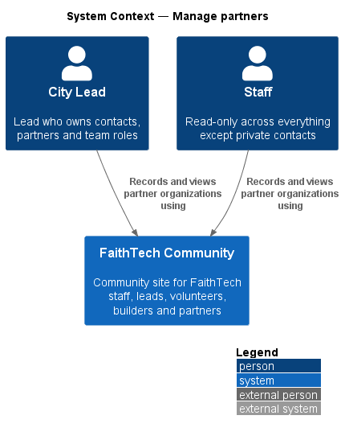
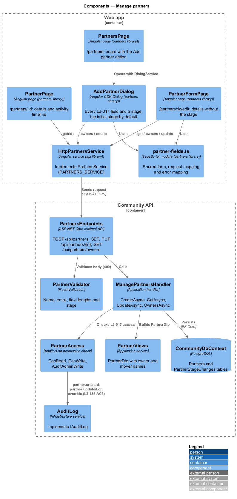
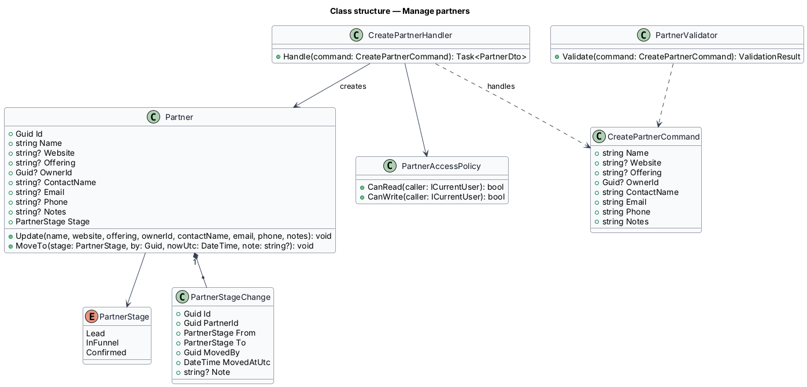
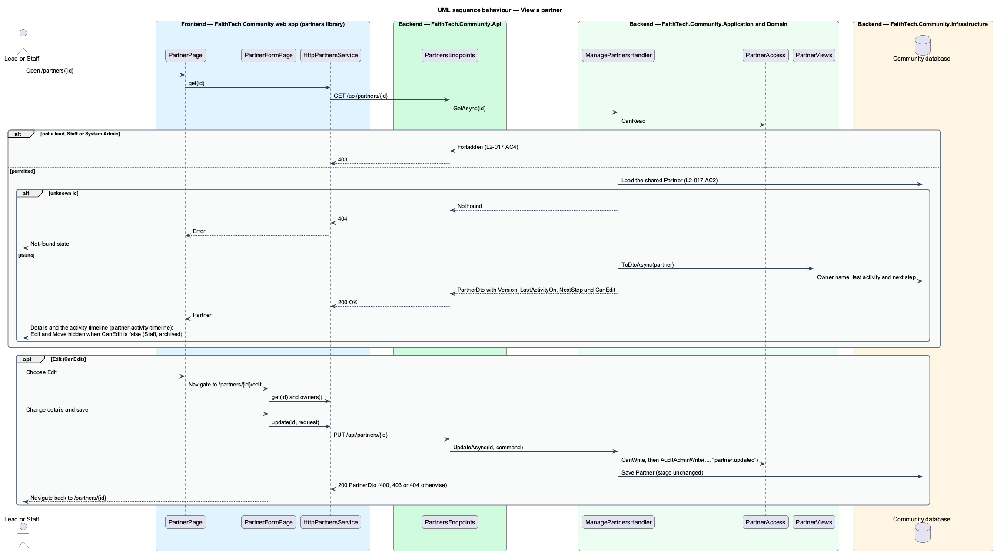

# Manage partners

## Overview

A **partner** — organization FaithTech works with or hopes to work with, such as a church, company or school. Leads track partners in one shared **partner pipeline** — the single set of partner records every lead sees and works on together, with no per-lead or per-city copies.

This feature covers creating, viewing and editing partner records. A new partner enters the pipeline at the Lead stage. Staff and System Admin can see the pipeline; Staff cannot change it. Moving partners between stages is the `partners/partner-kanban-board` slice.

## Description

- **`PartnersPage`** — the board page in the `partners` feature library (see `partners/partner-kanban-board`); it hosts the Add partner action.
- **`AddPartnerDialog`** — CDK dialog collecting name (required), website, offering, owner (a lead), contact name, email, phone, notes and stage (Lead by default).
- **`PartnerPage`** — partner detail page; Edit navigates to an edit screen. Write actions are hidden for Staff.
- **`PartnersService`** / **`PARTNERS_SERVICE`** / **`HttpPartnersService`** — API client for `GET /api/partners`, `GET /api/partners/{id}`, `POST /api/partners` and `PUT /api/partners/{id}`.
- **`PartnersEndpoints`** — minimal API mapping.
- **`CreatePartnerCommand`**, **`UpdatePartnerCommand`**, **`GetPartnerQuery`** and handlers in Application `Partners/`, with **`PartnerValidator`** requiring a name and a valid email when present.
- **`PartnerAccessPolicy`** — read: any lead role, Staff or System Admin; write: any lead role or System Admin. Others receive `403`.
- **`Partner`** — Domain entity; new partners start at `PartnerStage.Lead` unless another stage is chosen. `Update(...)` edits the details but never the stage.

Which lead roles may write partners: `decisions.txt` lists partners under City Lead, while `L2-017` says "a lead" and refuses only users "without a lead role, Staff or System Admin". The design grants writes to any lead role and System Admin through `PartnerAccessPolicy`; confirmation of the role set is `<TO SUPPLY>`.

## Requirements

The feature realizes the following level-2 (L2) requirements. Each L2 requirement refines a level-1 (L1) requirement, cited by identifier.

| L2 ID | Refines (L1) | Requirement |
|-------|--------------|-------------|
| `L2-017` | `L1-006` | Partner records |

### Acceptance criteria

**`L2-017` — Partner records**

1. Given a lead, when they add a partner with a name, an optional website, offering, owner (a lead), contact details and notes, and a stage (Lead by default), then the partner appears in that stage.
2. Given a partner, when any lead, Staff or System Admin views it, then all leads see the same record (one shared pipeline).
3. Given Staff, when they view partners, then they cannot create, edit or move partners, and the API returns 403 for writes.
4. Given a user without a lead role, Staff or System Admin, when they request partners, then the response is 403.

## Diagrams

### System context

Leads create and edit partners; Staff view them read-only. All see the same shared pipeline.

### Containers

The `partners` feature library in the Angular web app calls the Community API over HTTPS with an OAuth2 bearer token. The API persists state in the PostgreSQL Community database.

### Components

Every partner handler consults `PartnerAccessPolicy` before touching the shared pipeline.

### Class structure

`Partner` holds a `PartnerStage` and composes its stage history. `PartnerAccessPolicy` separates read and write rights.

### Behaviour — add a partner

A permitted lead creates a partner that enters the Lead stage; Staff and other callers receive `403`.

### Behaviour — view a partner

Every permitted reader sees the same shared record (`L2-017` AC2).

## Open questions

Decisions recorded while building the Domain layer (`FaithTech.Community.Domain`):

- `L2-017` adds website, offering and an owner (a lead) to a partner; `Partner` carries `Website`, `Offering` and `OwnerId`. Resolved.
- Domain rule violations throw `InvalidOperationException` (a broken rule) or `ArgumentException` (invalid input); there is no shared domain exception type. Handlers check permissions and preconditions first and map any remaining violation to a `400` or `409` result.
