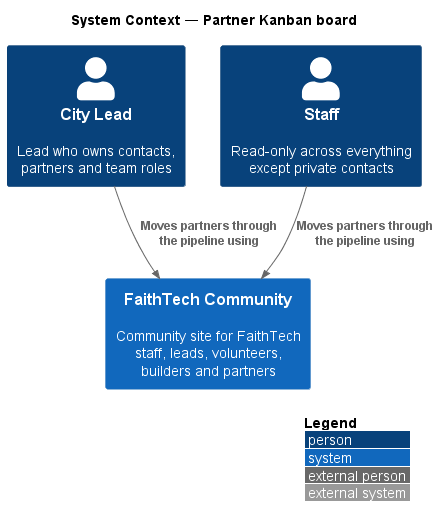
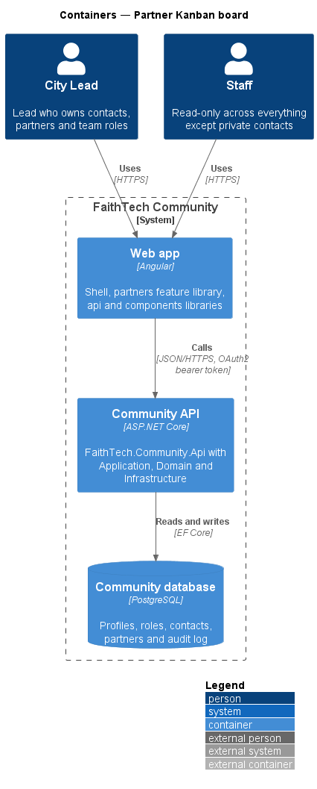
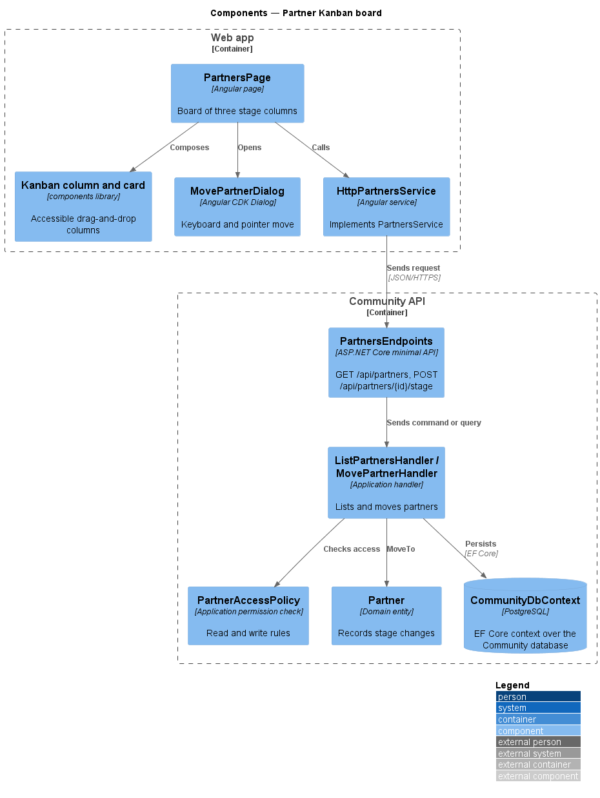
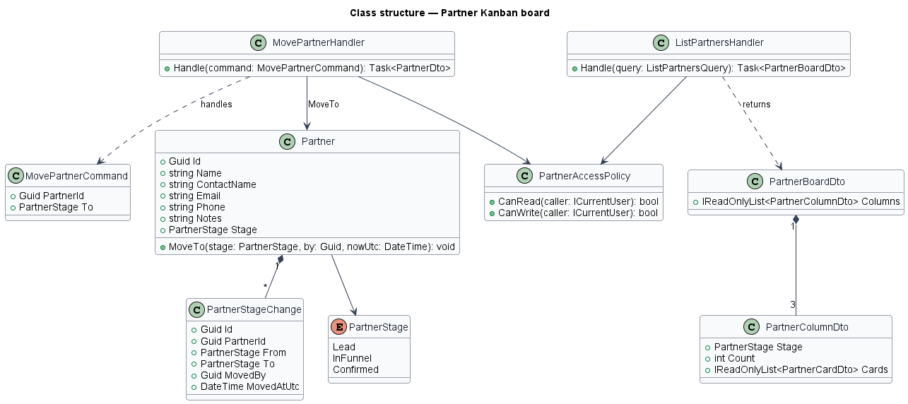
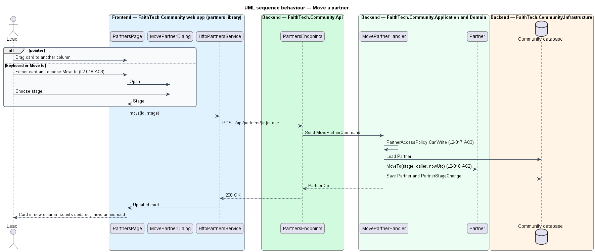

# Partner Kanban board

## Overview

The partner pipeline is shown as a **Kanban board** — view of work items arranged in columns by stage. The partner board has three columns, in order: Lead, In Funnel and Confirmed, each with a count. A lead moves a partner to another stage by dragging its card, by the "Move to" dialog, or by keyboard alone. Each move is recorded with who made it and when.

At extra-small viewports the board shows the stages as tabs with one column visible at a time.

## Description

- **`PartnersPage`** — board page in the `partners` feature library. It groups partners by stage and renders one Kanban column per stage, or stage tabs at XS widths.
- **Kanban column and card components** — from the `components` library, built on Angular CDK drag and drop. A focused card exposes a Move action reachable by keyboard.
- **`MovePartnerDialog`** — CDK dialog listing the other stages; used from the card's Move to action and as the keyboard path.
- **`PartnersService`** — `list()` and `move(id, stage)` calling `GET /api/partners` and `POST /api/partners/{id}/stage`.
- **`PartnersEndpoints`** — maps the board routes.
- **`ListPartnersQuery`** / **`ListPartnersHandler`** — returns partners with counts per stage; requires `PartnerAccessPolicy.CanRead`.
- **`MovePartnerCommand`** / **`MovePartnerHandler`** — requires `CanWrite`, calls `Partner.MoveTo`, which appends a `PartnerStageChange` with `MovedBy` and `MovedAtUtc`.
- Stage moves are not restricted to adjacent stages; any stage may move to any other.

Behaviour when two leads move the same card at the same time: last write wins; an optimistic concurrency token is `<TO SUPPLY>`.

## Requirements

The feature realizes the following level-2 (L2) requirements. Each L2 requirement refines a level-1 (L1) requirement, cited by identifier.

| L2 ID | Refines (L1) | Requirement |
|-------|--------------|-------------|
| `L2-018` | `L1-006` | Partner Kanban board |

### Acceptance criteria

**`L2-018` — Partner Kanban board**

1. Given the partners page, when it loads, then partners appear in three columns, Lead, In Funnel and Confirmed, each with a count.
2. Given a lead, when they drag a partner to another column, or use the "Move to" dialog with an optional note, then its stage changes and the move is recorded in the partner's history with who made it, when, and the note.
3. Given a keyboard-only user, when they focus a partner card, then they can move it to another stage without a pointer.
4. Given an XS viewport, when the board is shown, then the stages are shown as tabs with one column visible at a time.

## Diagrams

### System context

Leads move partners on the board; Staff view the board read-only.

### Containers

The `partners` feature library in the Angular web app calls the Community API over HTTPS with an OAuth2 bearer token. The API persists state in the PostgreSQL Community database.

### Components

The page composes library Kanban components; moves go through `MovePartnerHandler`, which records the change on `Partner`.

### Class structure

`Partner.MoveTo` appends a `PartnerStageChange`. Both handlers depend on `PartnerAccessPolicy`.

### Behaviour — load the board

The board loads three columns with counts; at XS the page renders tabs (`L2-018` AC1, AC4).

### Behaviour — move a partner

Drag, the Move to dialog and the keyboard path all send the same command; the move is recorded with actor and time (`L2-018` AC2, AC3).

