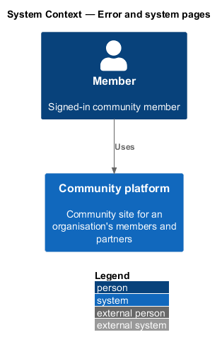
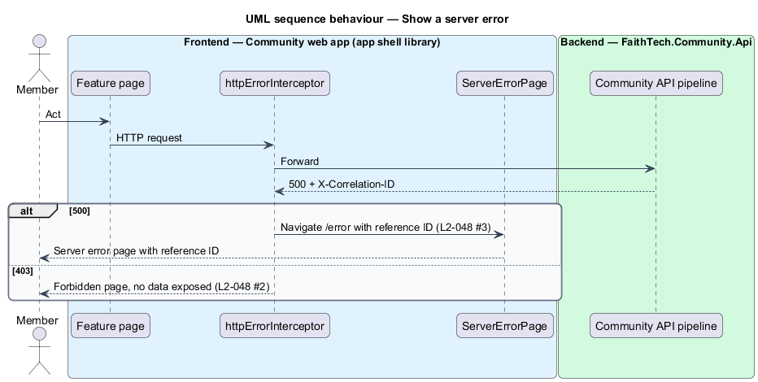
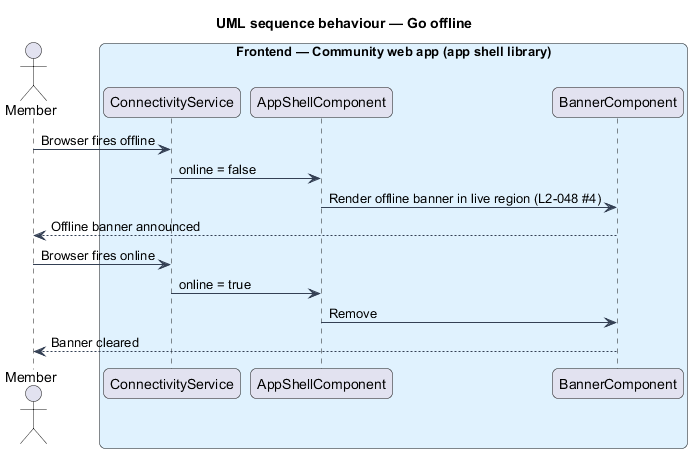

# Error and system pages

## Overview

The Community platform shows a clear, recoverable page when a route is unknown, an action is forbidden, the server fails or the browser goes offline, and a neutral page when a host maps to no organisation, the organisation is suspended, or a signed-in account is not a member of the organisation on this host. The app pages live in the app shell so every feature library reaches them the same way; the unknown-host and suspended pages are rendered by the API before the apps are served. The mocks are `pages/not-found`, `pages/forbidden`, `pages/server-error`, `pages/offline`, `notifications/banner`, `pages/unknown-host`, `pages/not-a-member` and `pages/organisation-suspended`.

- **reference ID** — correlation ID shown on the server error page so a member can quote it and an operator can find the matching log entry (`L2-047`)
- **offline banner** — persistent banner shown while the browser reports no network connection
- **unknown-host page** — neutral 404 page that `OrganisationResolutionMiddleware` answers on a host that maps to no organisation; it names no organisation and offers no link (`L2-131` AC2)
- **suspended page** — neutral 503 page answered on the host of a suspended organisation; it names no reason and serves nothing of the apps (`L2-131` AC3, `L2-150`)
- **not-a-member page** — app page shown to a verified account that has no profile in the current organisation (`L2-132` AC3)

## Description

Every API query behind these pages is scoped by the DbContext's global filter on `ICurrentOrganisation`.

- **`NotFoundPage`**, **`ForbiddenPage`**, **`ServerErrorPage`** — standalone pages in the `faithtech-community` app, composed from `components`. `NotFoundPage` links home and to search; `ForbiddenPage` explains missing access without naming the resource; `ServerErrorPage` shows the reference ID.
- **`NotAMemberPage`** — standalone page in the `faithtech-community` app at `/not-a-member`, composed from `components`. It says "You're not a member of {organisation name}", explains that joining is by sign-up, invite or connect link, offers a sign-out link and, when `/api/me` answered with the account's other memberships, a link to each of their hosts (`L2-048` AC6). The shell navigates to it when `/api/me` answers `403` with `reason: not-a-member` (`L2-132` AC3); the API answers `403` to every other call from that account on this host (`docs/detailed-designs/organisations/accounts-and-memberships`).
- **Unknown-host and suspended pages** — static neutral HTML answered by `OrganisationResolutionMiddleware` in the API, after the private-preview wall and before authentication, static files and routing, so no app file, API call or sign-in is served on such a host (`L2-048` AC5, AC7; `docs/detailed-designs/organisations/tenancy-and-host-resolution`). The unknown-host page answers 404 with "There's nothing here"; the suspended page answers 503 saying the community is unavailable. Neither names an organisation, a reason or a link; `/health/live` still answers.
- **Wildcard route** — `{ path: '**', component: NotFoundPage }` registered last in the shell routes.
- **`httpErrorInterceptor`** — functional HTTP interceptor in the `api` library. On 403 it navigates to `/forbidden`, or to `/not-a-member` when the problem details carry `reason: not-a-member`; on 500 it navigates to `/error` with the `X-Correlation-ID` response header as state. A 404 from the API leaves handling to the page, which shows its not-found state. A `403` for an action the shell believed allowed also reloads `/api/me` (`L2-133` AC5).
- **`ConnectivityService`** — `components` service exposing an `online` signal from `navigator.onLine` and the `online`/`offline` window events.
- **`BannerComponent`** — `components` banner that the shell renders while `online` is false, inside a live region.

## Requirements

The feature realizes the following level-2 (L2) requirements. Each L2 requirement refines a level-1 (L1) requirement, cited by identifier.

| L2 ID | Refines (L1) | Requirement |
|-------|--------------|-------------|
| `L2-048` | `L1-018` | Error and system pages |
| `L2-131` | `L1-025`, `L1-018` | Resolving the organisation from the host |
| `L2-132` | `L1-025`, `L1-001`, `L1-002` | Accounts and memberships |

### Acceptance criteria

**`L2-048` — Error and system pages**

1. Given an unknown route, when it is opened, then a 404 page offers a link home.
2. Given a forbidden action, when the user reaches it, then a 403 page explains that they lack access, without exposing data.
3. Given an unhandled server error, when it occurs, then a 500 page shows a reference ID that matches the logged correlation ID.
4. Given the browser goes offline, when the user acts, then an offline banner appears, and it clears when the connection returns. If a page cannot load at all, a full offline page offers to try again.
5. Given a host that maps to no organisation (`L2-131` AC2), when any path is opened, then a neutral unknown-host page answers 404 with "There's nothing here", names no organisation, offers no link, and exposes no data.
6. Given a verified account with no profile in the current organisation (`L2-132` AC3), when it signs in on that host, then the not-a-member page says "You're not a member of {organisation name}", explains that joining is by sign-up, invite or connect link, offers a sign-out link and, when the account has other memberships, a link to each of their hosts.
7. Given the host of a suspended organisation (`L2-131` AC3, `L2-150`), when any path is opened, then a neutral suspended page answers 503 saying the community is unavailable, names no reason, and serves no sign-in, API call or static file of the apps.

**`L2-131` — Resolving the organisation from the host**

1. Given a request on a host that maps to an active organisation, when `OrganisationResolutionMiddleware` runs (after the private-preview wall and before authentication, static files and routing), then the organisation is the current one for the rest of the request.
2. Given a request on a host that maps to no organisation, when it is received, then every path answers 404 with the neutral unknown-host page (`L2-048`), which names no organisation and nothing is logged beyond the request log; `/health/live` still answers.
3. Given a request on the host of a suspended organisation (`L2-150`), when it is received, then every path answers 503 with the neutral suspended page, and no sign-in, API call or static file of the apps is served.
4. Given Development, when the host is `localhost`, then the organisation named by `Platform:DefaultOrganisationSlug` is current.
5. Given a token, header, cookie, query string or body that names an organisation, when it arrives, then it is ignored: only the host decides.
6. Given CORS, when a preflight or request carries an `Origin`, then only the current organisation's community and public origins are allowed, with credentials (`L2-101` AC3, ADR 0018).

**`L2-132` — Accounts and memberships**

1. Given a visitor signs up on an organisation's host (`L2-001`, `L2-078`, `L2-083`), when the account is created, then a profile is created in that organisation, and when the email already has an account, then on verification the existing account gains a profile in that organisation if it has none, with the same `202` outcome either way.
2. Given an invite (`L2-011`) or a connect link (`L2-083`), when it is accepted, then the profile is created in the inviter's or link owner's organisation, whatever host the acceptor started on.
3. Given a verified account with no profile in the current organisation, when it signs in on that host, then the not-a-member page is shown ("You're not a member of {organisation name}") with a sign-out link and, when the account has other memberships, links to their hosts; every API call answers 403 and `/api/me` answers 403 with `reason: not-a-member`.
4. Given an account with profiles in several organisations, when it is used on one host, then only that organisation's profile, roles, capabilities, photos, contacts, notifications and data are visible or counted (`L2-130`).
5. Given a profile is suspended (`L2-039`), when the account signs in on that organisation's host, then sign-in is refused with "Your membership of {organisation name} is suspended"; on another host where it holds an active profile, sign-in succeeds.
6. Given an account locked by a platform operator (`L2-148`), when it signs in on any host, then sign-in is refused with the suspended-account message of `L2-003` AC4.
7. Given a password reset, email verification or Google sign-in (`L2-002`, `L2-004`, `L2-078`), when it completes, then it applies to the account everywhere; it creates no membership.

## Diagrams

### System context

A member uses the Community platform and sees a recoverable page when something fails; a visitor on an unknown or suspended host sees a neutral page.

### Containers

The app's system pages live in the web app; the Community API supplies the status code and correlation ID, and renders the unknown-host and suspended pages itself.

### Components

The shell wildcard route serves `NotFoundPage`. `httpErrorInterceptor` routes 403 and 500 responses to their pages, including `NotAMemberPage`, and `ConnectivityService` drives the offline banner. `OrganisationResolutionMiddleware` answers the unknown-host and suspended pages before the apps.

### Class structure

`httpErrorInterceptor` navigates to `ForbiddenPage`, `NotAMemberPage` or `ServerErrorPage`; `ServerErrorPage` holds the reference ID; `NotAMemberPage` holds the organisation name and the other memberships.

### Behaviour — show a server error

A 500 response carries the correlation ID, which the server error page shows as its reference ID (`L2-048`).

### Behaviour — go offline

The offline banner appears when the browser loses its connection and clears when it returns (`L2-048`).

The unknown-host, suspended and not-a-member flows are sequenced in `docs/detailed-designs/organisations/tenancy-and-host-resolution` and `docs/detailed-designs/organisations/accounts-and-memberships`.

## Open questions

- Capabilities: the unknown-host, suspended and not-a-member pages are added for multi-tenancy; the first two are answered by the API before the apps, the third by the app on `reason: not-a-member` (ADR 0032).
