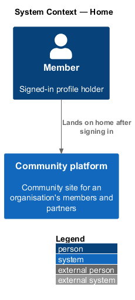
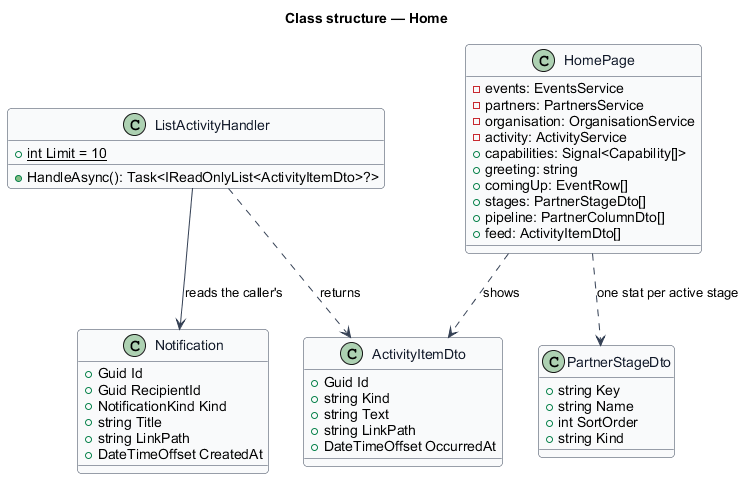
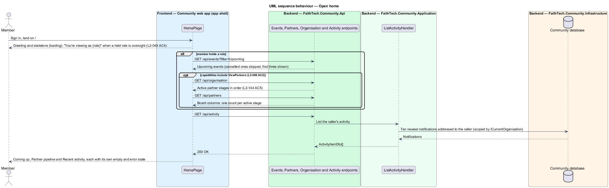

# Home

## Overview

**Home** is the page every signed-in member lands on at `/`. It summarizes what is coming up and what has happened, tailored to the member's capabilities (`L1-019`, `L2-135` AC7). It composes data that other features own: upcoming events, the partner pipeline, and the member's recent activity. It owns no data of its own.

The page follows the `docs/mocks/pages/home` mock in its states: `default` (a holder of `ManageEvents` and `KeepContacts`), `staff` (a holder of an oversight role), `empty` (a member with no role), `loading`, `error`, `pipeline-zero`, `pipeline-error` and `activity-error`.

## Description

- **`HomePage`** — the component of the shell's default child route, in the app project at `frontend/projects/faithtech-community/src/app/pages/home`. Home is not one feature's page: it reads from events, partners and notifications, and feature libraries must not depend on each other. So it stays a top-level route in the app, composed only of `components` and `api` services ([ADR 0016](../../../adr/0016-home-page-lives-in-the-app-shell.md)).
- **Greeting** — a `PageHeaderComponent` whose title is "Good morning", "Good afternoon" or "Good evening" (before 12:00, before 18:00, after) and the member's first name. Its subtitle is today's date and the count of upcoming events, for example "Tuesday 21 October · 3 events coming up", "1 event coming up" or "No events coming up". A skeleton stands in for the subtitle while events load. A member with no role sees "Welcome, {first name}" and "You’re part of the {organisation name} community. Here’s how to get started." (`L2-134`).
- **Quick actions** — in the header's actions slot. *New event* (`/events/new`) for a holder of `ManageEvents`. *Add contact* (`/contacts/new`) for a holder of `KeepContacts`. Each appears only to a holder of its capability, read from `capabilities` on `/api/me`; a member without either sees neither (`L2-049` AC2).
- **Oversight banner** — an info `AlertComponent`, "You’re viewing as {role}", for a member holding a role flagged oversight (`IsOversight`, `L2-136`; seeded as Staff in FaithTech), naming that role; no write action appears for a capability they lack (`L2-049` AC4).
- **Coming up** — a flush `CardComponent` headed "Coming up" with a `ListComponent` of `EventCardComponent`s: the first three events from `EVENTS_SERVICE.listEvents({ filter: 'Upcoming' })` that are not cancelled, soonest first. Each title links to `/events/{id}`. The meta line reads "Thu 6 Nov · 6:30 pm · Kestrel Labs, 220 King St W · 34 going", as on the events list, with the event's {chapter} name where it has one (`L2-141` AC2). A `CardFooterComponent` holds the *All events* link. With no upcoming events the card reads "Nothing coming up yet." While loading, a `ListSkeletonComponent` with date-badge rows stands in.
- **Page error** — when the events request fails, the whole page body is an error `EmptyStateComponent`, "We couldn’t load your home page", with *Try again*, which reloads every card (mock `error`).
- **Partner pipeline** — a `CardComponent` headed "Partner pipeline" with an *Open board* link to `/partners`, for a holder of `ViewPartners`, the capability that opens partners (ADR 0009, ADR 0033). One `StatComponent` per active partner stage of the organisation, in order, in a `ClusterComponent`, shows the count of that stage's column from `PARTNERS_SERVICE.getBoard()`; the stage names come from `GET /api/organisation` (`L2-144` AC3, AC5). While loading the stats show the organisation's active stage names over skeleton values. When every count is 0 the card adds "No partners yet. Add the first one from the board." When the request fails the card holds a danger `AlertComponent`, "We couldn’t load the partner pipeline", "The rest of the page is up to date.", with *Try again*, which reloads only the pipeline.
- **Recent activity** — a `CardComponent` headed "Recent activity" in the split's aside, holding a `FeedComponent` of `FeedItemComponent`s from `ACTIVITY_SERVICE.recent()`. Each item's text links to the item it is about; its meta line is the time, "Today, 11:42 am", "Yesterday, 4:10 pm" or "Mon 20 Oct" (`formatFeedTime` in `components`). The feed's own states cover loading (skeleton rows), empty ("No activity yet. New sign-ups, events and announcements show up here.") and error ("We couldn’t load recent activity" with *Try again*, which reloads only the feed).
- **Onboarding** — a member with no role sees, instead of Coming up and the pipeline, a `GridComponent` `auto` of three cards: "Finish your profile" (*Edit profile*, `/people/me/edit`), "Find an event" (*Browse events*, `/events`) and "Want to get involved?" (*Meet the team*, `/team`), then the Recent activity card (mock `empty`).
- **`ActivityService`** / **`ACTIVITY_SERVICE`** / **`HttpActivityService`** — API client in `api` calling `GET /api/activity`.
- **`ActivityEndpoints`** — minimal API mapping `GET /api/activity`. It requires a signed-in caller (`401` anonymous) and only dispatches.
- **`ListActivityHandler`** in Application `Notifications/`. It returns the ten newest notifications addressed to the caller's profile in the current organisation, newest first, as `ActivityItemDto` (`Id`, `Kind`, `Text`, `LinkPath`, `OccurredAt`). Every query is scoped by the DbContext's global filter on `ICurrentOrganisation`. A caller without a profile in the organisation gets `403`.

### Permissions

The feed holds only notifications addressed to the caller, so it can never show another member's data. A private contact's sign-up reaches only the holder of `KeepContacts` who owns the contact (`L2-012`, `L2-015`), and nothing in the feed reaches a holder of a view-only role or anyone else. The pipeline counts come from `GET /api/partners`, which already refuses every caller without `ViewPartners`; the page does not even ask for other members. Events come from the events list, which every member may read.

## Requirements

| L2 ID | Refines (L1) | Requirement |
|-------|--------------|-------------|
| `L2-049` | `L1-019` | Home page |
| `L2-045` | `L1-016` | Responsive layout and theming |
| `L2-144` | `L1-028`, `L1-006` | Partner stages |

### Acceptance criteria

**`L2-049` — Home page**

1. Given a signed-in member, when they open home, then they see a greeting with today's date, a "Coming up" list of their next events, and a recent-activity feed of things they are permitted to see.
2. Given a member with a capability behind one of these, when home is shown, then the quick action "New event" is shown to a holder of `ManageEvents`, "Add contact" to a holder of `KeepContacts`, and a partner pipeline summary (one count per active stage, `L2-144` AC5, and "Open board") to a holder of `ViewPartners`; each appears only to a holder of its capability.
3. Given a member with no role, when home is shown, then an onboarding state offers "Finish your profile", "Find an event" and "Meet the team".
4. Given a member holding a role flagged oversight (`L2-136`), when home is shown, then a "You're viewing as {role}" banner is shown, and no write action appears for a capability they lack.
5. Given the recent-activity feed is loading, has nothing to show or fails to load, when home is shown, then the "Recent activity" card stays in place with skeleton rows, the line "No activity yet. New sign-ups, events and announcements show up here." or a "We couldn't load recent activity" alert with a Try again button, and the rest of home is unaffected.
6. Given a holder of `ViewPartners`, when the partner pipeline summary is loading, has no partners or fails to load, then the "Partner pipeline" card stays in place with the organisation's active stage names over skeleton values, a count of 0 under each stage with "No partners yet. Add the first one from the board.", or a "We couldn't load the partner pipeline" alert with a Try again button, and the rest of home is unaffected.
7. Given a signed-in member, when the recent-activity feed loads, then it lists at most the ten newest notifications addressed to that member, newest first, each linking to its item, and never anything addressed to another member.
8. Given the upcoming events fail to load, when home is shown, then "We couldn't load your home page" is shown with a Try again button that loads home again.

**`L2-045` — Responsive layout and theming**

1. Given any screen at XS, SM, MD, LG and XL widths, when it renders, then there is no horizontal page scroll, and touch targets are at least 24x24 CSS pixels.
2. Given an XS viewport, when the app shell renders, then the navigation collapses into a menu.
3. Given the operating system prefers a dark theme, when the app loads, then the dark theme is used.
4. Given a signed-in member, when the app shell renders, then the top bar, the phone tab bar and the menu list only the sections the member's capabilities (`/api/me`, `L2-133` AC2) may open, from one rule: Home, Events, Team, Announcements, Resources and Notes for everyone; Contacts for `KeepContacts`; Partners for `ViewPartners`; Workspaces for `OwnWorkspaces`, `JoinWorkspaces` or `ReadAllWorkspaces`; People for `ViewPeopleDirectory`; Reports for `ViewReports` (`L2-123`); Organisation for `ManageRoles` or `ManageOrganisationSettings` (`L2-147` AC1); Admin for `AdministerOrganisation`. The tab bar is Home, Events, Search, the member's next section and More, which opens the menu of every section and is the current tab whenever the page is outside the other four.
5. Given a viewport from MD up to 1535px, when the app shell renders, then the secondary sections (Team, Announcements, Resources, People, Reports, Organisation, Admin) are hidden from the top bar and a "More" button at the end of the top-bar nav opens the menu of every section, so no section is reachable only from Home; from 2XL (1536px, `--layout-breakpoint-2xl`) the secondary links join the top bar and More hides.
6. Given a signed-in member on Settings, when they choose Light, Dark or "Match my device" under Appearance, then the theme changes at once without saving the form, the choice is remembered on this device (browser storage), and "Match my device" returns to following the operating system.

**`L2-144` — Partner stages**

1. Given a holder of `ManageOrganisationSettings` on Stages & types (`/organisation/taxonomies`), when they view "Partner stages", then it lists the active stages in order with their partner counts, which is the initial stage, and each stage's kind (Open or Confirmed), and offers add, rename, reorder, set as initial, set kind and archive; the writes are under `/api/organisation/partner-stages` and audited under `taxonomies`.
2. Given the stages, when they are saved, then exactly one active stage is initial, at least one active stage exists, and a name is required, up to 40 characters and unique among active stages ignoring case; a violation answers 400 with an inline error.
3. Given the Kanban board (`L2-018`), when it renders, then it shows one column per active stage in order (tabs on XS) with that stage's partners, and a new partner (`L2-017` AC1) starts on the initial stage.
4. Given a partner on an archived stage, when the board renders, then it is listed in an "Archived stage: {name}" column at the end until moved; moving a partner onto an archived stage is refused with 400.
5. Given Home's pipeline card (`L2-049` AC6) and Reports' "partners confirmed" (`L2-125`), when they count, then they count partners whose stage kind is Confirmed, and show one count per active stage.
6. Given the stage history, merge dialog and timeline "Stage moves" (`L2-017`, `L2-111`, `L2-114`), when a stage is renamed, then history shows the current name; when archived, then history shows the name with "(archived)".
7. Given a stage with partners, when it is archived, then the request is refused with 409 "{n} partners are on this stage. Move them first." (an archived stage keeps no partners).

## Diagrams

### System context

Any signed-in member opens home. Anonymous visitors are sent to sign in (`L2-005`).

### Containers

The app shell's home route calls the Community API for events, partners and activity.

### Components

`HomePage` composes three API services and reads the organisation's stage names from `/api/organisation`. Only the activity endpoint is new.

### Class structure

`ListActivityHandler` reads the caller's `Notification` rows and returns `ActivityItemDto` items; `HomePage` keeps one pipeline count per active `PartnerStage`.

### Behaviour — open home

Each card loads on its own, so one failure leaves the rest of home in place (`L2-049` AC5, AC6).

## Open questions

- Where Home lives: the app project, as a top-level route composed of `components` and `api`. Resolved in [ADR 0016](../../../adr/0016-home-page-lives-in-the-app-shell.md).
- What feeds Recent activity: the caller's own notifications, because they are addressed to one member and so can never leak private data. Resolved for v1.
- Community-wide activity is a gap. The mock also shows items such as "Marcus Lee published Toronto Builders Night" and "Hannah Kim sent “November hackathon: teams are forming”" to members those items were not addressed to. Events record no publish time, announcements and the notification actor are being built in draft PR #335, and sign-ups record no time. Until those land, the feed shows only the caller's notifications. Each item's avatar is the organisation's name until notifications carry their actor (PR #335), when the avatar shows the person who acted.
- "Their next events" is read as the next upcoming events across every {chapter}, not only those the member RSVP'd to, because events are organisation-wide and the mock's Coming up shows events with their RSVP counts. Cancelled events are left out of Coming up. Resolved.
- The mock has no state for a member with a role and no upcoming events. The Coming up card then reads "Nothing coming up yet." Resolved.
- The onboarding card links to "Meet the team"; the mock's "Meet the Toronto team" needs the member's home {chapter}, which the signed-in user did not carry. Resolved: "Meet the team".
- Capabilities: the quick actions, the pipeline card and the banner are keyed on `ManageEvents`, `KeepContacts`, `ViewPartners` and the oversight flag instead of role names, and the pipeline shows one count per active stage of the organisation (ADR 0033, ADR 0035).
