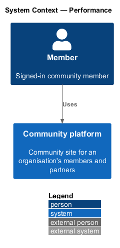
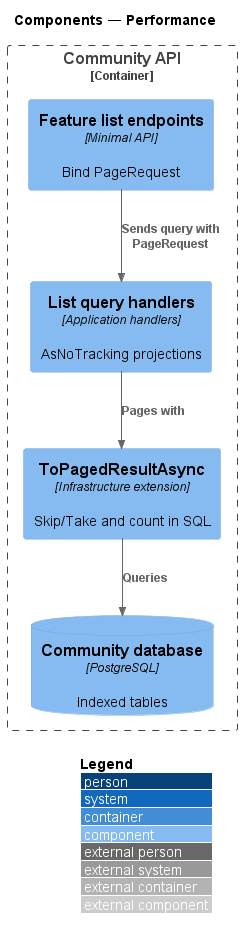
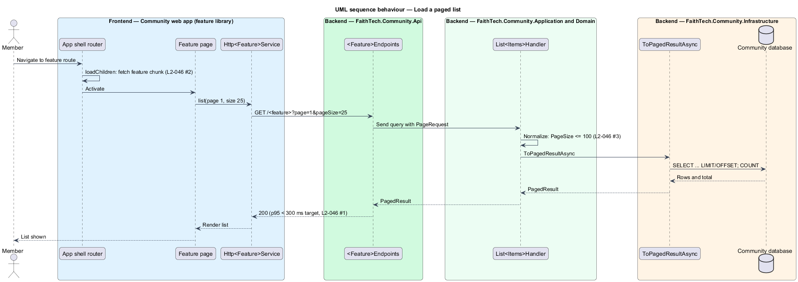

# Performance

## Overview

This design describes the shared measures that keep FaithTech Community responsive: bounded, paged queries on the server and a small, lazy-loaded bundle on the client.

- **p95 latency** — response time under which 95 percent of requests complete
- **page** — bounded slice of a list result, described by page number and page size
- **lazy loading** — loading a feature library only when its route is first visited
- **LCP** — Largest Contentful Paint, the time until the largest visible element renders

## Description

- **`PageRequest`** / **`PagedResult<T>`** — Application types shared by every list query. `PageRequest` clamps `PageSize` to a maximum of 100.
- **`ToPagedResultAsync`** — Infrastructure `IQueryable` extension that applies `Skip`/`Take` and a count in the database.
- **Keyset pages** — lists that grow at the top while someone reads them, or that people page through with filters, use a keyset continuation instead of a page number. A page returns `{ items, next, totalCount }`, where `next` encodes the sort key of the last row. The invites list (newest first, then id) and the team list (lower-cased name, then id, ADR 0015) work this way. They clamp the page size to the same maximum of 100, default to 50, and answer `400` for a continuation they did not give out.
- **Read queries** — use `AsNoTracking()` and projections to DTOs, so only needed columns load.
- **Indexes** — EF Core migrations add indexes for foreign keys, sort keys and the Postgres full-text `tsvector` columns used by search.
- **Shell routes** — the app shell lazy-loads each feature library with `loadChildren`, keeping the initial bundle small.
- **Angular budgets** — `angular.json` sets an initial bundle budget; the gzipped initial JavaScript limit is 300 KB.
- **Load test** — the load-test tool and scenario for 200 concurrent users are `<TO SUPPLY>`.

## Requirements

The feature realizes the following level-2 (L2) requirements. Each L2 requirement refines a level-1 (L1) requirement, cited by identifier.

| L2 ID | Refines (L1) | Requirement |
|-------|--------------|-------------|
| `L2-046` | `L1-017` | Performance |

### Acceptance criteria

**`L2-046` — Performance**

1. Given 200 concurrent users, when read endpoints are called, then the p95 latency is under 300 ms, and under 600 ms for writes.
2. Given a cold load over a 4G connection, when the app opens, then Largest Contentful Paint is under 2.5 seconds, and the initial JavaScript is under 300 KB gzipped, with feature libraries lazy-loaded.
3. Given a list endpoint, when it is called, then the results are paged, with a maximum page size of 100.

## Diagrams

### System context

A member uses FaithTech Community, which answers within the latency targets of `L2-046`.

### Containers

The web app loads feature libraries lazily, and the Community API returns paged results from indexed tables.

### Components

List endpoints bind a `PageRequest`, and handlers page in SQL through `ToPagedResultAsync`.

### Class structure

`PageRequest` clamps the page size to 100; `ToPagedResultAsync` returns a `PagedResult<T>`.

### Behaviour — load a paged list

The first visit to a feature route loads its library lazily; the list request returns at most 100 items (`L2-046`).

