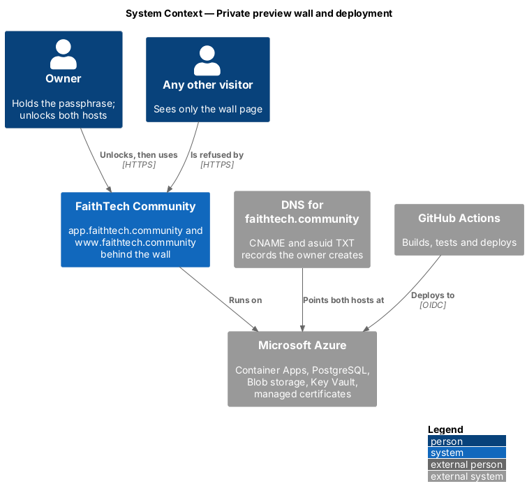
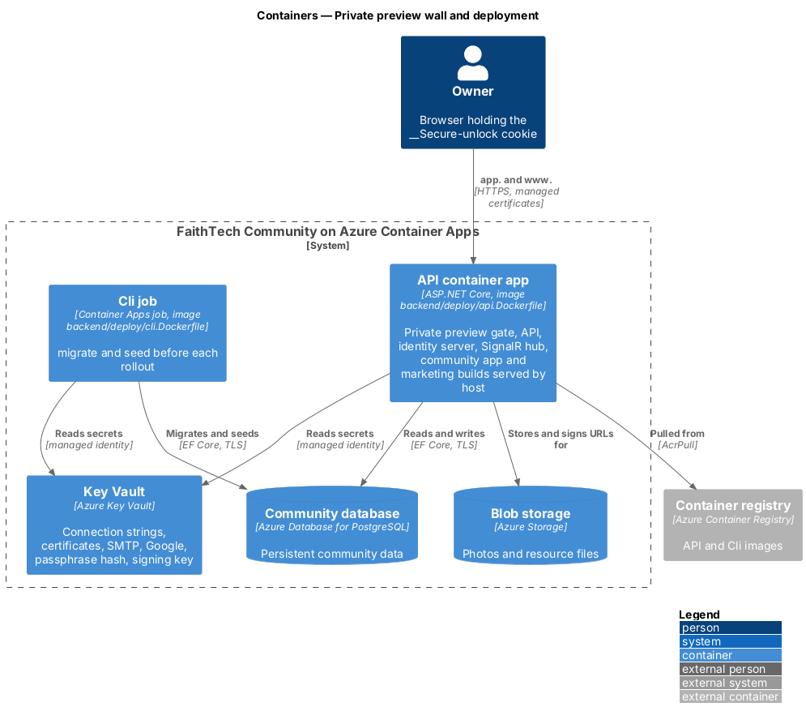
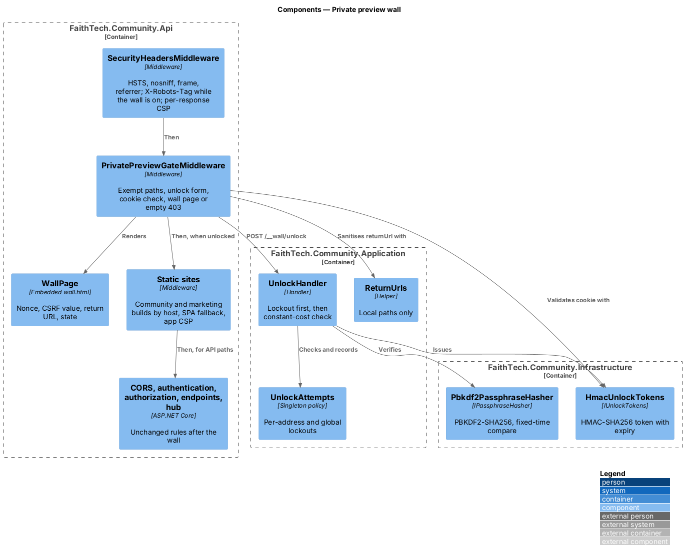
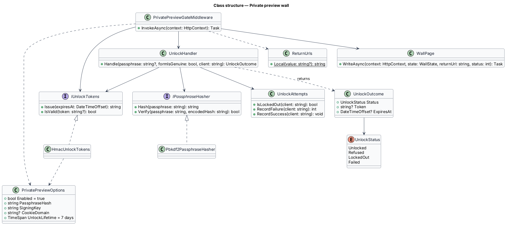
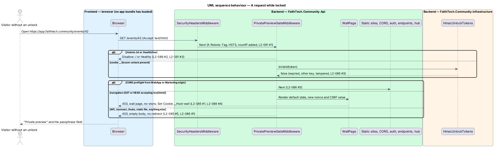
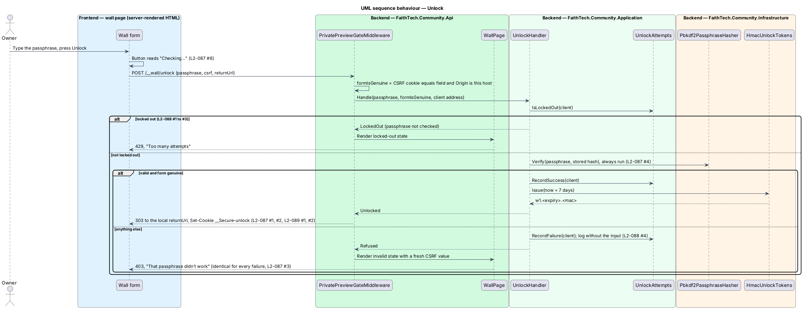
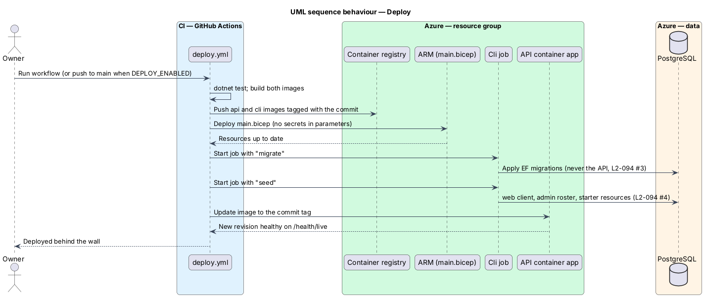

# Private preview wall and deployment

## Overview

FaithTech Community is deployed to two hosts that share the parent domain `faithtech.community`: the community app, the API and the identity server on `app.faithtech.community`, and the marketing page on `www.faithtech.community` (ADR 0018, whose note that hosting was deferred this design resolves). While the product is in private preview, both hosts sit behind a wall. The wall works like a paywall: a visitor first sees a locked page, and only the owner, who knows a passphrase, gets past it to the site as it is today.

- **wall** — the server-side gate in front of every request to either host; it refuses everything until the visitor holds a valid unlock
- **wall page** — the neutral page the gate renders for a locked navigation: the title "Private preview", one passphrase field and an *Unlock* button, and nothing that names, describes or colours the product (`docs/mocks/pages/private-preview`)
- **owner** — the one person who holds the passphrase; there are no wall accounts
- **unlock** — a signed token in the `__Secure-unlock` cookie, valid for 7 days, for the whole parent domain
- **lockout** — a pause on unlock attempts after repeated failures, per client address and globally, that grows on each repeat
- **exempt path** — one of the four requests the gate answers while locked: the wall page, `POST /__wall/unlock`, `GET /robots.txt` and `GET /health/live`

The wall is enforced by the server, so a visitor who never runs the apps' JavaScript, calls the API directly, opens a static file, starts an OIDC flow or opens a WebSocket is refused in the same way. It does not replace sign-in: once past the wall, authentication, roles and every permission rule in `docs/detailed-designs/platform/server-authorization` apply unchanged, and public events are public only to visitors who have passed the wall.

The same change makes the product deployable: one container image serves the API and both production Angular builds by host, a second image runs the Cli project, Bicep templates in `eng/infra/` describe the Azure resources, and a GitHub Actions workflow builds, migrates and rolls out. The wall stays on until `PrivatePreview:Enabled` is set to `false`.

## Description

### Where the wall is enforced

The API process is the only server. It fronts the static apps itself, so the wall is one ASP.NET Core middleware rather than a separate gate service or reverse proxy (ADR 0023). Rules live in `FaithTech.Community.Application/PrivatePreview/`, hashing and signing in `FaithTech.Community.Infrastructure/PrivatePreview/`, and the HTTP glue in `FaithTech.Community.Api/Middleware/PrivatePreview/`.

The pipeline in `Program.cs` runs, in order: `CorrelationIdMiddleware`, `SecurityHeadersMiddleware`, the Serilog request log, **`PrivatePreviewGateMiddleware`**, the exception handler and status code pages, **static sites**, CORS, authentication, `CurrentRolesMiddleware`, the rate limiter, authorization and the endpoints. Because the gate sits before the exception handler and the status code pages, a locked response is exactly what the gate writes: no problem-details body, no framework wording. Because it sits before routing, no endpoint, hub or static file is reached while locked.

### Application — `PrivatePreview/`

- **`PrivatePreviewOptions`** — section `PrivatePreview`: `Enabled` (default `true`; only `appsettings.Development.json` turns it off), `PassphraseHash`, `SigningKey` (base64, at least 32 bytes), `CookieDomain` (`faithtech.community` in production, empty for host-only) and `UnlockLifetime` (7 days). The API validates them on start when the wall is on and refuses to start without a readable hash and key (`L2-087` AC7).
- **`IPassphraseHasher`** — `Hash(passphrase)` and `Verify(passphrase, encodedHash)`.
- **`IUnlockTokens`** — `Issue(expiresAt)` and `IsValid(token)`.
- **`UnlockAttempts`** — singleton lockout policy over `TimeProvider`. Per client address: 5 failures within 15 minutes start a lockout of 1 minute, doubling on each repeat to at most 60; a success or 24 quiet hours resets it. Globally: 100 failures within 15 minutes lock every address out for 15 minutes, doubling to at most 4 hours. State is in memory (bounded to 10,000 addresses, oldest first out), so the container app runs one replica while the wall is on (`L2-088`).
- **`UnlockHandler`** — `Handle(passphrase, formIsGenuine, clientAddress)` returns `Unlocked(token, expiresAt)`, `Refused`, `LockedOut` or `Failed`. It checks the lockout first and, when locked out, does not verify the passphrase. Otherwise it always runs the slow hash, even when the CSRF check already failed, so every refusal costs the same time; it refuses passphrases over 1,024 characters after hashing a fixed dummy value. It logs `Wall unlock refused for {ClientAddress} ({RecentFailures} recent failures)` and never the passphrase, its length or any token (`L2-087`, `L2-088` AC4).
- **`ReturnUrls.Local(value)`** — keeps a path that starts with a single `/`, has no `\` or control characters and is at most 2,048 characters; anything else becomes `/` (`L2-087` AC2).

### Infrastructure — `PrivatePreview/`

- **`Pbkdf2PassphraseHasher`** — PBKDF2-HMAC-SHA256 with a 16-byte random salt, 600,000 iterations and a 32-byte key, encoded `pbkdf2-sha256$600000$<salt>$<hash>` (base64). `Verify` reads the iteration count from the string and compares with `CryptographicOperations.FixedTimeEquals`.
- **`HmacUnlockTokens`** — token `w1.<expiresAt unix seconds>.<HMAC-SHA256(key, "w1." + expiresAt)>`, base64url. `IsValid` recomputes the MAC, compares in constant time and checks the expiry against `TimeProvider`, whatever the browser kept. Rotating `PrivatePreview:SigningKey` invalidates every token at once (`L2-089`, `L2-090`).

### Api — `Middleware/PrivatePreview/`

- **`PrivatePreviewGateMiddleware`** — when the wall is off, calls the next middleware and does nothing else. When it is on:
  - `GET /robots.txt` → `User-agent: *` / `Disallow: /`, locked or not.
  - `GET /health/live` → next middleware (the liveness check only; `/health/ready` stays behind the wall).
  - `POST /__wall/unlock` → reads the form (at most 4 KB), checks the CSRF cookie against the form field and any `Origin` header against the request host, then calls `UnlockHandler`. Unlocked: 303 to `ReturnUrls.Local(returnUrl)` with the unlock cookie. Refused: 403 and the wall page with the inline error. Locked out: 429 and the lockout alert. Failed: 500 and the error alert.
  - A valid `__Secure-unlock` cookie → next middleware.
  - A CORS preflight from `WebApp:Origin` or `Marketing:Origin` → next middleware (preflights never carry cookies, and the CORS policy answers them before any endpoint runs).
  - A navigation (`GET` or `HEAD` accepting `text/html`) → 403 and the wall page with `Cache-Control: no-store`.
  - Anything else → 403 with an empty body. Nothing is ever redirected while locked.
- **`WallPage`** — renders `wall.html`, an embedded resource, with a fresh CSP nonce, a fresh CSRF value (also set as the host-only `__Host-wall` cookie), the HTML-encoded `returnUrl` and the state. The template holds the design system's auth layout, card, form field, alert and button rules inline, read by role, under the neutral accent (`patterns/private-preview-wall.html`), plus a five-line script that shows the busy state. The form works without the script. The e2e fake renders the same file, so the Playwright suite exercises the real markup.
- **`PrivatePreviewSetup`** — `AddPrivatePreview(configuration)` binds and validates the options and registers the Application and Infrastructure services; `UsePrivatePreview()` adds the gate.
- **`SecurityHeadersMiddleware`** — unchanged headers on every response, plus `X-Robots-Tag: noindex, nofollow` while the wall is on, and the response's own CSP when one is set on `HttpContext.Items` (the wall page's nonce policy, the apps' policy). Kestrel's `Server` header is turned off (`L2-091`).

### Api — static sites

- **`StaticSitesSetup.UseStaticSites()`** — when `StaticSites:AppRoot` and `StaticSites:MarketingRoot` are set (the container sets them to `/app/sites/app` and `/app/sites/www`), a request whose host is the host of `WebApp:Origin` or `Marketing:Origin` and whose path is not `/api`, `/connect`, `/.well-known`, `/hubs` or `/health` is served from that build. A path with no file falls back to `index.html`, the SPA route. Hashed files are `Cache-Control: private, max-age=31536000, immutable`; `index.html` is `no-cache`. HTML gets the app CSP: `default-src 'self'; script-src 'self'; style-src 'self' 'unsafe-inline'; img-src 'self' data: blob: <StaticSites:ImageOrigins>; media-src 'self' blob:; font-src 'self' data:; connect-src 'self' <WebApp:Origin> <wss WebApp:Origin>; frame-ancestors 'none'; base-uri 'self'; form-action 'self' <WebApp:Origin>; object-src 'none'`. Photos load from the Blob storage origin (ADR 0002), so `StaticSites:ImageOrigins` names it. In development and in the tests nothing is configured and the Angular dev servers serve the apps as before (`L2-093`).

### Cli

- **`wall-hash`** — reads one line from standard input, refuses fewer than 16 characters, prints the PBKDF2 string. The passphrase is never echoed, logged or written anywhere (`L2-090` AC2).
- **`wall-key`** — prints 32 random bytes in base64 (`L2-090` AC3).
- `migrate` and `seed` are unchanged; production runs both, in that order, before every rollout. `seed` is the production seed: the `web` OpenIddict client for `WebApp:Origin`, the System Admin roster and the starter resources. `seed-load-users`, `seed-search-records` and `reset` are never run in production.

### Deployment — `backend/deploy/`, `eng/infra/`, `.github/workflows/`

- **`backend/deploy/api.Dockerfile`** — stage 1 builds both Angular apps with their production configurations (`COMMUNITY_ORIGIN` = `https://app.faithtech.community`, session hint domain `faithtech.community`, no source maps); stage 2 publishes the API; stage 3 is `mcr.microsoft.com/dotnet/aspnet:10.0`, runs as the non-root `app` user on port 8080 and copies the builds to `/app/sites/app` and `/app/sites/www`.
- **`backend/deploy/cli.Dockerfile`** — publishes the Cli project; entry point `dotnet FaithTech.Community.Cli.dll`.
- **`backend/deploy/compose.yaml`** — local smoke test: PostgreSQL, Azurite, the Cli (`migrate`, `seed`) and the API image with the wall on, on `http://localhost:8080`.
- **`eng/infra/main.bicep`** — resource-group scope: Log Analytics, a Container Apps environment, Azure Container Registry, a user-assigned identity with `AcrPull` and Key Vault Secrets User, Key Vault (RBAC, purge protection), PostgreSQL flexible server (Burstable B1ms, PostgreSQL 16, TLS required), a Storage account (HTTPS only, no public blob access), the API container app (external ingress on 8080, HTTP redirected to HTTPS, one replica, liveness and startup probes on `/health/live`, every secret a Key Vault reference) and a manual Container Apps job for the Cli. With `customDomainsReady=true` it adds both custom domains and managed certificates (CNAME validation) and binds them with SNI. `eng/infra/main.bicepparam` holds only non-secret values.
- **Configuration in production** — `ASPNETCORE_ENVIRONMENT=Production`, `WebApp__Origin=https://app.faithtech.community`, `Marketing__Origin=https://www.faithtech.community` (CORS for the marketing hand-off), `PrivatePreview__CookieDomain=faithtech.community`, `StaticSites__ImageOrigins=https://<storage>.blob.core.windows.net`, `ASPNETCORE_FORWARDEDHEADERS_ENABLED=true` (the client address is the last `X-Forwarded-For` entry, appended by the ingress, `L2-088` AC5). Secrets from Key Vault: `ConnectionStrings__Community`, `ConnectionStrings__Blobs`, `Identity__SigningCertificate`, `Identity__EncryptionCertificate`, `Smtp__*`, `Google__ClientId`, `Google__ClientSecret`, `PrivatePreview__PassphraseHash`, `PrivatePreview__SigningKey`.
- **`.github/workflows/deploy-assets.yml`** — on pull requests that touch the backend, the deploy folders or the workflow: builds and tests the backend, builds both images and builds and lints the Bicep.
- **`.github/workflows/deploy.yml`** — on `workflow_dispatch` (and on pushes to `main` once the repository variable `DEPLOY_ENABLED` is `true`): signs in to Azure with OIDC, builds and pushes both images tagged with the commit, deploys `main.bicep`, runs the Cli job with `migrate` then `seed`, waits for success and only then updates the API's image.
- **`runbook.md`** — what the owner runs and supplies: DNS records, secrets, passphrase and key, migrations, rotation and lifting the wall.

### Lifting the wall

Set `PrivatePreview__Enabled=false` on the container app (the `privatePreviewEnabled` Bicep parameter) and roll out. The gate then passes every request, `X-Robots-Tag` and the wall's `robots.txt` stop, and `/__wall/unlock` no longer exists (`L2-092`). The key and hash secrets can then be deleted.

### Open questions and deferred

- Data Protection keys are not persisted, so with the in-memory key ring a restart invalidates outstanding email verification, reset and unsubscribe tokens. One replica keeps them consistent between restarts; persisting the key ring (Blob storage plus Key Vault) is deferred.
- The apex `faithtech.community` and any redirect from it are deferred.
- Multiple wall users, invitations to the preview, magic links and SSO at the wall are out of scope (prompt "Deferred").
- Provisioning Azure, creating DNS records and setting the real passphrase are the owner's steps (`runbook.md`).

## Requirements

The feature realizes the following level-2 (L2) requirements. Each L2 requirement refines a level-1 (L1) requirement, cited by identifier. Marketing (`L2-074` to `L2-079`), identity (`L2-001` to `L2-004`, `L2-078`) and server authorization (`L2-042`) are referenced, not repeated.

| L2 ID | Refines (L1) | Requirement |
|-------|--------------|-------------|
| `L2-085` | `L1-022` | The locked view reveals nothing about the product |
| `L2-086` | `L1-022` | Every path is refused while locked |
| `L2-087` | `L1-022` | Unlock with the owner passphrase |
| `L2-088` | `L1-022` | Brute-force protection |
| `L2-089` | `L1-022` | The unlock cookie |
| `L2-090` | `L1-022` | Revocation and passphrase rotation |
| `L2-091` | `L1-022` | Headers, noindex and robots |
| `L2-092` | `L1-022` | Lifting the wall |
| `L2-093` | `L1-022` | Serving both apps behind the wall |
| `L2-094` | `L1-022` | Deployment over HTTPS |

The acceptance criteria are in `docs/specs/L2.md`.

## Diagrams

### System context

Every visitor reaches FaithTech Community through the wall; only the owner holds the passphrase. Azure hosts it and DNS points both hosts at it.

### Containers

One container app serves the API, the identity server and both Angular builds by host; a Container Apps job runs the Cli for migrations and seeding. Secrets come from Key Vault.

### Components

The gate runs before routing, the exception handler and static files, so a locked request reaches nothing else; the Application and Infrastructure parts decide and sign.

### Class structure

`UnlockHandler` combines the lockout policy, the hasher and the token signer behind Application interfaces.

### Behaviour — a request while locked

A navigation gets the wall page; any other request gets an empty 403; the exempt paths are answered (`L2-085`, `L2-086`).

### Behaviour — unlock

The owner posts the passphrase; a lockout, a refusal and a success each get one fixed response (`L2-087` to `L2-089`).

### Behaviour — deploy

The workflow pushes images, applies the infrastructure, migrates and seeds through the Cli job, and only then rolls out the API (`L2-094`).

