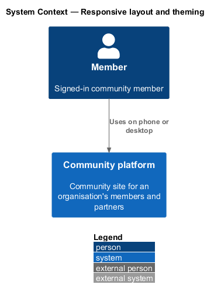
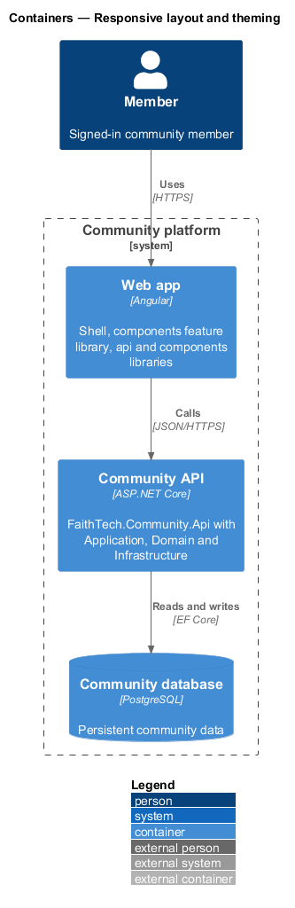
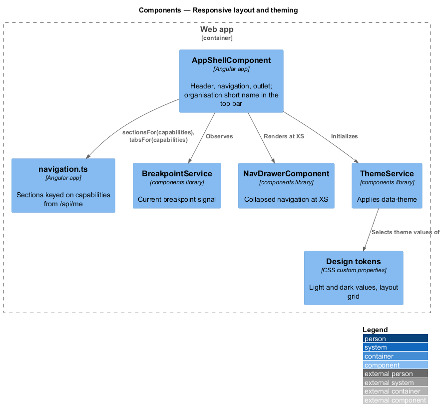
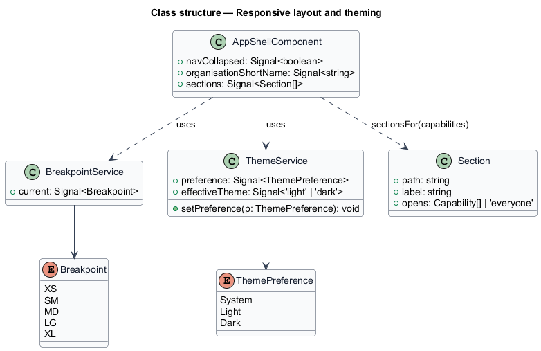
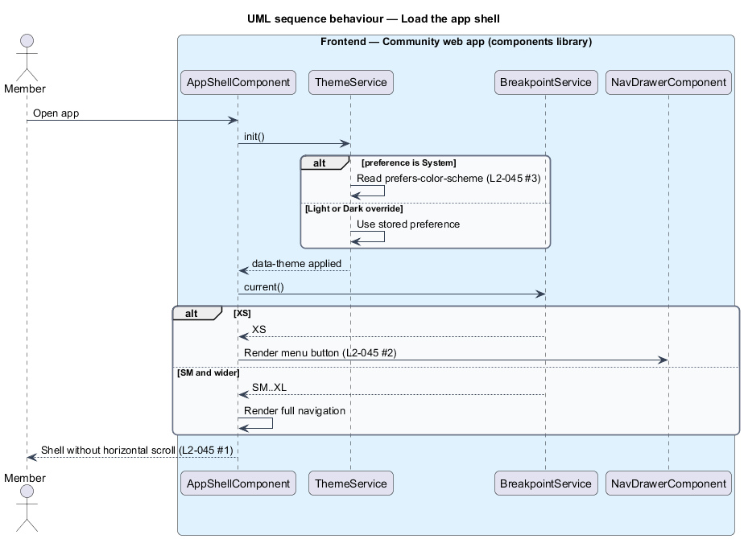

# Responsive layout and theming

## Overview

FaithTech Community runs on phones and desktops and in light and dark themes. This design describes the shared layout grid, breakpoints and theme switching that the app shell and the `components` library provide.

- **breakpoint** — named viewport width threshold: XS <576px, SM >=576px, MD >=768px, LG >=992px, XL >=1200px
- **theme** — set of colour token values; light and dark themes define the same role names
- **theme preference** — member choice of `system`, `light` or `dark`; `system` follows `prefers-color-scheme`

## Description

- **Layout tokens** — breakpoint, gutter, margin and spacing custom properties in `components` (from `docs/design-system/`).
- **`AppShellComponent`** — shell in the `faithtech-community` app. Under 768px the tab bar's More opens `NavDrawerComponent` from `components`; from 768px to 1023px `TopBarComponent`'s More (`moreLabel`, `more`) opens the same drawer while the secondary links are hidden; from 1024px the top bar shows every section.
- **Navigation by role** — `shell/navigation.ts` in the app holds the ordered sections and the roles that may open each; `sectionsFor(roles)` feeds the top bar and the menu, `tabsFor(roles)` the phone tab bar's links, followed by `TabBarComponent`'s More button that opens `NavDrawerComponent` and is current (`aria-current="true"`) when no link tab is (ADR 0009). The API still enforces every permission.
- **`BreakpointService`** — `components` wrapper over CDK `BreakpointObserver` exposing the current named breakpoint as a signal.
- **`ThemeService`** — `components` service that applies `data-theme="light|dark"` on `<html>`. With preference `system` it follows `matchMedia('(prefers-color-scheme: dark)')`.
- **Theme preference storage** — the settings page (mock `pages/settings`) sets the preference. Whether it persists in the profile through the API or in browser storage only is `<TO SUPPLY>`.
- **Touch targets** — interactive components set a minimum of 24x24 CSS pixels through a size token.
- **Playwright viewport projects** — the e2e suite runs layout specs at one width per breakpoint in Chromium and asserts no horizontal page scroll.

## Requirements

The feature realizes the following level-2 (L2) requirements. Each L2 requirement refines a level-1 (L1) requirement, cited by identifier.

| L2 ID | Refines (L1) | Requirement |
|-------|--------------|-------------|
| `L2-045` | `L1-016` | Responsive layout and theming |

### Acceptance criteria

**`L2-045` — Responsive layout and theming**

1. Given any screen at XS, SM, MD, LG and XL widths, when it renders, then there is no horizontal page scroll, and touch targets are at least 24x24 CSS pixels.
2. Given an XS viewport, when the app shell renders, then the navigation collapses into a menu.
3. Given the operating system prefers a dark theme, when the app loads, then the dark theme is used. The user can override the theme in settings.
4. Given a signed-in member, when the app shell renders, then the top bar, the phone tab bar and the menu list only the sections the member's roles may open, from one rule: Home, Events, Team and Announcements for everyone; Contacts for leads and System Admin; Partners for leads, Staff and System Admin; People for City Lead, Staff and System Admin; Admin for System Admin. The tab bar is Home, Events, Search, the member's next section and More, which opens the menu of every section and is the current tab whenever the page is outside the other four.
5. Given an MD viewport (768px to 1023px), when the app shell renders, then the secondary sections are hidden from the top bar and a "More" button at the end of the top-bar nav opens the menu of every section, so no section is reachable only from Home.

## Diagrams

### System context

A member uses FaithTech Community on any device width and theme.

### Containers

Layout and theming live entirely in the web app.

### Components

`AppShellComponent` observes `BreakpointService` to collapse navigation at XS and initializes `ThemeService`, which selects light or dark token values.

### Class structure

`ThemeService` resolves a `ThemePreference` to an effective theme; `BreakpointService` exposes the current `Breakpoint`.

### Behaviour — load the app shell

On load the shell picks the theme from the stored preference or the operating system and collapses navigation at XS (`L2-045`).

