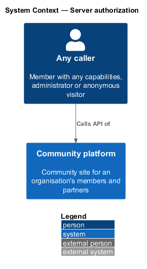
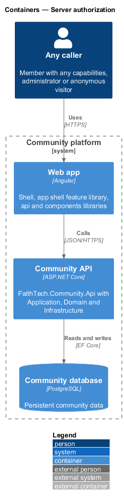
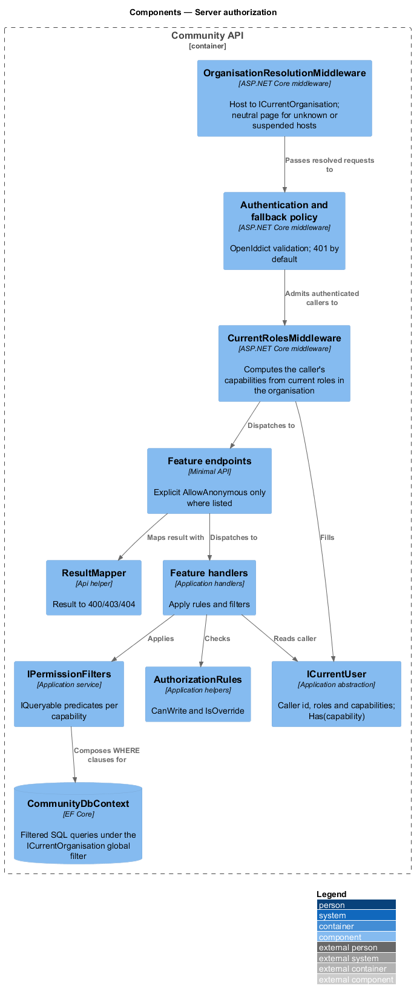
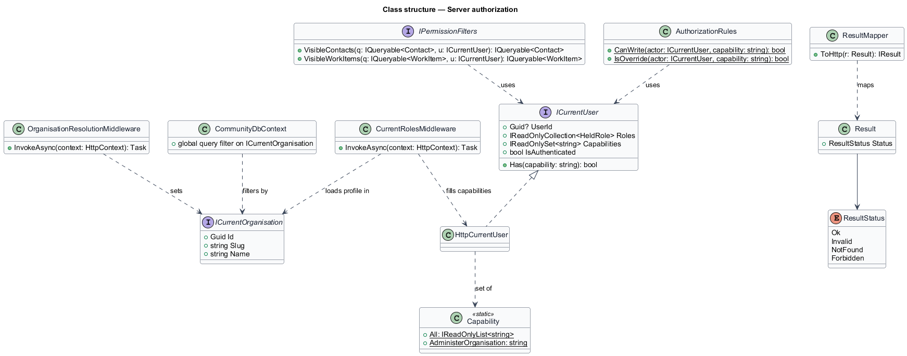
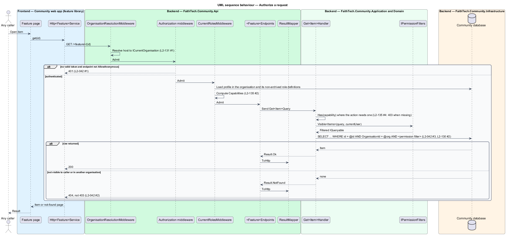

# Server authorization

## Overview

The Community platform enforces every permission on the server. The UI may hide controls, but no data reaches a caller that the server has not authorized. This design describes the shared authorization mechanism that every feature endpoint and handler uses.

- **fallback policy** — ASP.NET Core authorization policy applied to every endpoint that does not opt out, requiring an authenticated caller
- **anonymous endpoint** — endpoint explicitly marked with `AllowAnonymous`; `L2-042` lists the permitted set
- **permission filter** — predicate added to an EF Core query so that the database returns only rows the caller may see
- **existence hiding** — answering 404 rather than 403 for a resource the caller may not see
- **capability** — named right from the platform catalogue that a role definition carries; the server authorizes by capability, never by role name (`L2-135`, ADR 0033)
- **current organisation** — the organisation resolved from the request host; every scoped query is filtered to it (`L2-130`, ADR 0032)

The domain rules in `AGENTS.md` define what a capability lets a caller see: private contacts and their notes belong to the holder of `KeepContacts` who created them and to a holder of `AdministerOrganisation`, a caller without a write capability answers 403, and profiles are visible to signed-in members only. The catalogue itself and the access classes that read it are described in `docs/detailed-designs/organisations/capabilities-and-authorization`.

## Description

- **Fallback authorization policy** — configured in `Program.cs` with `RequireAuthenticatedUser()`, so every endpoint answers 401 to an unauthenticated call by default.
- **`AllowAnonymous` endpoints** — public events, guest RSVP, sign-up, sign-in, password reset, verification, invite acceptance and announcement unsubscribe. No other endpoint carries the marker.
- **Private preview wall** — while `PrivatePreview:Enabled` is on, `PrivatePreviewGateMiddleware` refuses every request without a valid unlock before organisation resolution, routing and authentication run, so even the `AllowAnonymous` endpoints above (public events, guest RSVP, sign-up, sign-in) are reachable only past the wall. The wall adds a gate in front; it changes none of the rules in this design, which apply unchanged once the visitor has unlocked (`L2-101` AC4, `docs/detailed-designs/platform/private-preview-wall`, ADR 0026).
- **`OrganisationResolutionMiddleware`** and **`ICurrentOrganisation`** — run after the wall and before authentication, static files and routing (`L2-131` AC1). The middleware maps the request host to an active organisation and exposes it as `ICurrentOrganisation`; an unknown or suspended host is answered with a neutral page before anything else runs. Only the host decides: a token, header, cookie, query string or body that names an organisation is ignored (`L2-131` AC5). `CommunityDbContext` applies a global query filter on `ICurrentOrganisation` to every scoped entity, so every query in this design is scoped by the DbContext's global filter on `ICurrentOrganisation` and an id from another organisation is simply not found (`L2-130` AC2, AC3; `docs/detailed-designs/organisations/tenancy-and-host-resolution`).
- **`ICurrentUser`** — Application abstraction exposing `UserId`, `Roles` (held assignments), `Capabilities`, `IsAuthenticated` and `Has(capability)`. `Has` is true when the set contains the capability or contains `AdministerOrganisation` (`L2-135` AC3). `HttpCurrentUser` in the Api project takes `UserId` from the OpenIddict-validated principal's subject. It takes the roles and capabilities from `CurrentRolesMiddleware`, which runs right after authentication, loads the caller's profile in the current organisation on every request, and computes the union of the capabilities of every non-archived role definition the profile holds (`L2-135` AC2). A caller with no profile in the current organisation is refused as a non-member (`L2-132` AC3).
- **Capability freshness policy** — the server never authorizes with claims inside a token. Those claims are a snapshot from the moment the token was issued and survive refresh. Instead, every request reads the caller's current profile roles and computes their capabilities. A removed role, or a definition edit that drops a capability, stops working on the very next call, even with an old access token or one obtained by refreshing it. An added role or capability works at once. `/api/me` returns the current roles and capabilities, and the web app reloads them whenever it restores the session or receives a `403` for an action the shell believed allowed (`L2-133` AC5). Role changes therefore need no token revocation, and grant rules, last-administrator protection, notifications and auditing are unchanged (`L2-138`, `L2-139`, `L2-042` AC4).
- **`IPermissionFilters`** — Application service with query extensions such as `VisibleContacts(ICurrentUser)` and `VisibleWorkItems(ICurrentUser)` that compose `IQueryable` predicates, so list, search and export filters run in SQL, on top of the organisation filter.
- **`AuthorizationRules`** — Application helpers for write checks such as `CanWrite(actor, capability)` (false for a caller without the capability) and `IsOverride(actor, capability)`: true when the actor is allowed only because they hold `AdministerOrganisation`, lacking the specific capability or not owning the record. Every override is audited; an action the actor holds the capability for is not (`L2-135` AC5).
- **`NotFoundOrForbidden` convention** — handlers that load by ID through a permission filter return `Result.NotFound` when the filtered query finds nothing; endpoints map it to 404.
- **`ResultMapper`** — Api helper that maps `Result` states to HTTP: `NotFound` → 404, `Forbidden` → 403 (used only for actions on resources the caller may see), `Invalid` → 400.

## Requirements

The feature realizes the following level-2 (L2) requirements. Each L2 requirement refines a level-1 (L1) requirement, cited by identifier.

| L2 ID | Refines (L1) | Requirement |
|-------|--------------|-------------|
| `L2-042` | `L1-015` | Authorization on the server |
| `L2-135` | `L1-026`, `L1-015` | Capability catalogue and server authorisation |

### Acceptance criteria

**`L2-042` — Authorization on the server**

1. Given any API endpoint, when it is called without authentication, then the response is 401, except for the endpoints explicitly marked anonymous: public events, guest RSVP, sign-up, sign-in, password reset, verification, invite acceptance and announcement unsubscribe.
2. Given a resource the caller is not permitted to see, when it is requested by ID, then the response is 404, not 403, so that its existence is not revealed.
3. Given a list, search or export, when it is built, then the permission filters are applied in the database query, not after loading the data.
4. Given a role added to or removed from a user, when that user next calls the API, including with an access or refresh token issued before the change, then the server authorizes with the profile's current capabilities (`L2-135` AC2), and `/api/me` reports them.

**`L2-135` — Capability catalogue and server authorisation**

1. Given the platform, when `GET /api/organisation/capabilities` is called by any member, then it lists exactly: `ManageEvents`, `ViewAttendees`, `ManageAttendance`, `KeepContacts`, `ViewPartners`, `ManagePartners`, `InviteMembers`, `ConnectLink`, `OwnWorkspaces`, `JoinWorkspaces`, `ReadAllWorkspaces`, `ViewPeopleDirectory`, `AssignRoles`, `SendAnnouncements`, `AddResources`, `ViewReports`, `ManageRoles`, `ManageOrganisationSettings`, `AdministerOrganisation`, each with a one-line description, and no organisation can add, rename or remove one.
2. Given a request, when the server authorises it, then it checks the caller's capabilities, computed on that request from the union of the capabilities of every non-archived role the caller's profile holds in the current organisation, and never compares a role name.
3. Given a holder of `AdministerOrganisation`, when any capability is checked, then it is held.
4. Given an action that needs a capability the caller lacks, when it is called, then the response is 403 (or 404 where `L2-042` AC2 hides existence), and nothing changes.
5. Given an action the caller is allowed only because they hold `AdministerOrganisation` (they lack the specific capability, or do not own the record), when it succeeds, then it is an override and an audit entry is written (`L2-041`); given the caller holds the specific capability or owns the record, then it is not audited (role changes excepted, `L2-138` AC5).
6. Given every signed-in member of the organisation, when they view profiles, the team, events and announcements, RSVP, open resources and notes visible to them, create their own notes, search, or edit their own profile and settings, then no capability is required.
7. Given the frontend, when it decides what to show, then it reads capabilities from `/api/me`, never role names, and hiding is a convenience only: the server refuses what the member may not do.

## Diagrams

### System context

Every caller, signed in or anonymous, reaches the Community platform's data only through API checks.

### Containers

The web app hides controls by capability, but the Community API decides; the Community database returns only rows the API query permits, within the current organisation.

### Components

The wall and `OrganisationResolutionMiddleware` run first; the fallback policy rejects unauthenticated calls before any endpoint runs; `CurrentRolesMiddleware` computes the caller's capabilities. Handlers read `ICurrentUser` and apply `IPermissionFilters` inside the query, and `ResultMapper` turns results into status codes.

### Class structure

`HttpCurrentUser` realizes `ICurrentUser` and exposes the computed capability set. `IPermissionFilters` and `AuthorizationRules` depend on it, `CommunityDbContext` filters on `ICurrentOrganisation`, and `ResultMapper` maps `ResultStatus` to HTTP.

### Behaviour — authorize a request

An unauthenticated call stops at 401. An authenticated request by ID for an invisible resource, or one in another organisation, returns 404; a write without the needed capability returns 403; list queries apply filters in SQL (`L2-042`, `L2-135`).

## Open questions

- Capabilities: `ICurrentUser.HasRole(Role)` and the role-name comparisons are replaced by `Has(capability)` over a set computed per request, and every scoped query runs under `ICurrentOrganisation` (ADR 0032, ADR 0033).
