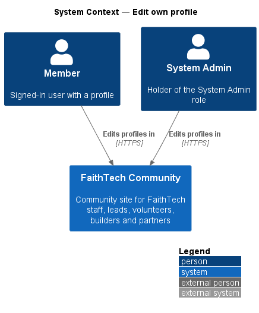
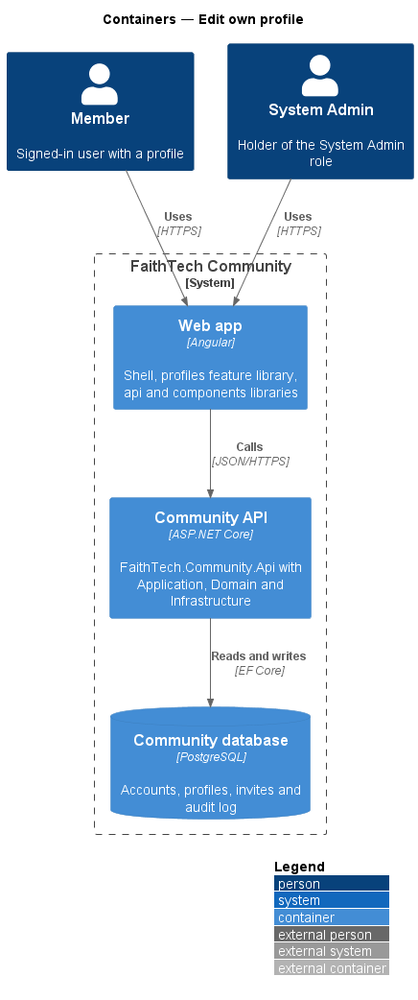
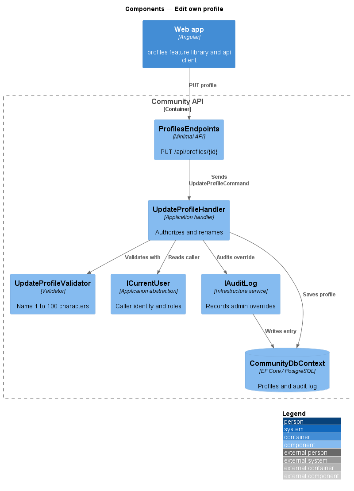
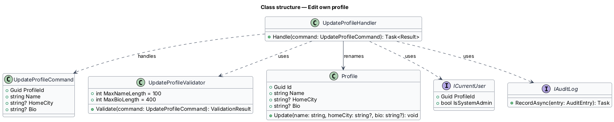
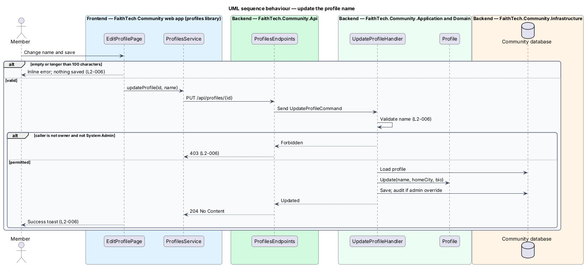

# Edit own profile

## Overview

Each member maintains the name, home city and bio on their own profile. *Edit own profile* covers changing them and the rule that only the owner, or a System Admin, may change a profile.

**owner** — the account whose `ProfileId` matches the profile

**System Admin override** — the System Admin's permission to change any profile, recorded in the audit log

The edit happens on the dedicated `edit-profile` screen, not inline, in line with the frontend conventions. A name is required and shall not exceed 100 characters; a bio shall not exceed 400 characters.

## Description

- **`EditProfilePage`** — page in the `profiles` feature library, matching the `edit-profile` mock. It uses `components` form fields, shows inline errors and a success toast.
- **`ProfilesService`** — contract in the `api` library, provided through the `PROFILES_SERVICE` injection token and implemented by `HttpProfilesService`.
- **`ProfilesEndpoints`** — minimal API route group in `FaithTech.Community.Api` under `/api/profiles`. Its endpoints require authentication by default and hold no business logic.
- **`ICurrentUser`** — Application abstraction exposing the caller's user id, profile id and roles.
- **`Profile`** — Domain entity holding `Name`, `Roles` and the `Photos` collection.
- **`UpdateProfileCommand`** — request carrying `ProfileId` and `Name`.
- **`UpdateProfileCommand`** carries `ProfileId`, `Name`, `HomeCity` and `Bio`.
- **`UpdateProfileValidator`** — rejects an empty name, a name longer than 100 characters or a bio longer than 400 characters.
- **`UpdateProfileHandler`** — Application handler. It returns forbidden unless the caller owns the profile or is System Admin, calls `Profile.Update(name, homeCity, bio)`, saves, and writes an audit entry through `IAuditLog` when the caller is a System Admin editing another profile.
- **`IAuditLog`** — Infrastructure audit writer.

## Requirements

The feature realizes the following level-2 (L2) requirements. Each L2 requirement refines a level-1 (L1) requirement, cited by identifier.

| L2 ID | Refines (L1) | Requirement |
|-------|--------------|-------------|
| `L2-006` | `L1-002` | Edit own profile |

### Acceptance criteria

**`L2-006`**

1. Given a signed-in user, when they change their name, home city or bio and save, then the profile updates and a success toast is shown.
2. Given an empty name or a name longer than 100 characters, when they save, then an inline error is shown and nothing is saved.
3. Given a user who is not a System Admin, when they try to edit another user's profile through the API, then the response is 403.
4. Given a bio longer than 400 characters, when they save, then an inline error is shown.

## Diagrams

### System context

Members edit their own profile; System Admins may edit any profile.

### Containers

The web app sends the update to the Community API, which writes the profile and any audit entry to the Community database.

### Components

`ProfilesEndpoints` forwards an `UpdateProfileCommand` to `UpdateProfileHandler`, which validates, authorizes against `ICurrentUser`, renames the profile and audits admin overrides.

### Class structure

`UpdateProfileHandler` depends on the command, its validator, `ICurrentUser` and `IAuditLog`, and mutates `Profile` through `Update`.

### Behaviour — update the profile name

The page and the validator reject invalid names. The handler returns 403 to any caller who is neither the owner nor System Admin, and otherwise saves and confirms with a toast (`L2-006`).

## Open questions

Decisions recorded while building the Domain layer (`FaithTech.Community.Domain`):

- `L2-006` covers name, home city and bio while this design covered only the name. `Profile.Update(name, homeCity, bio)` replaces `Rename`; it rejects a blank name, and length limits stay in the validator. Resolved.
