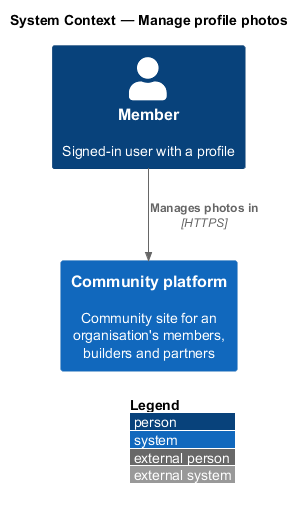
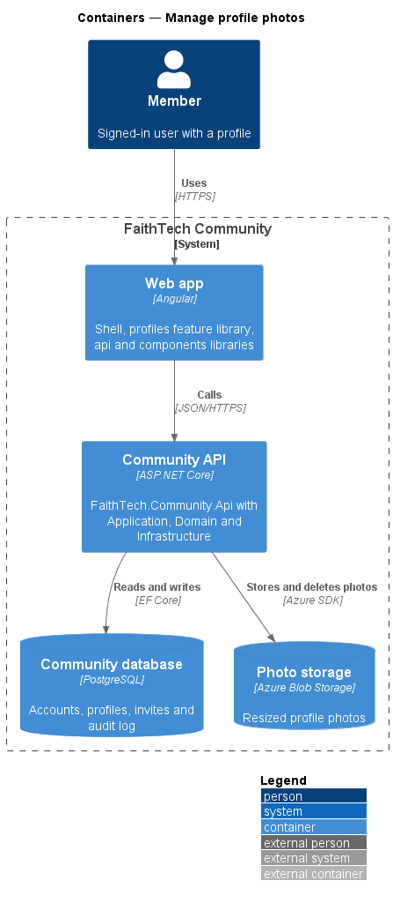
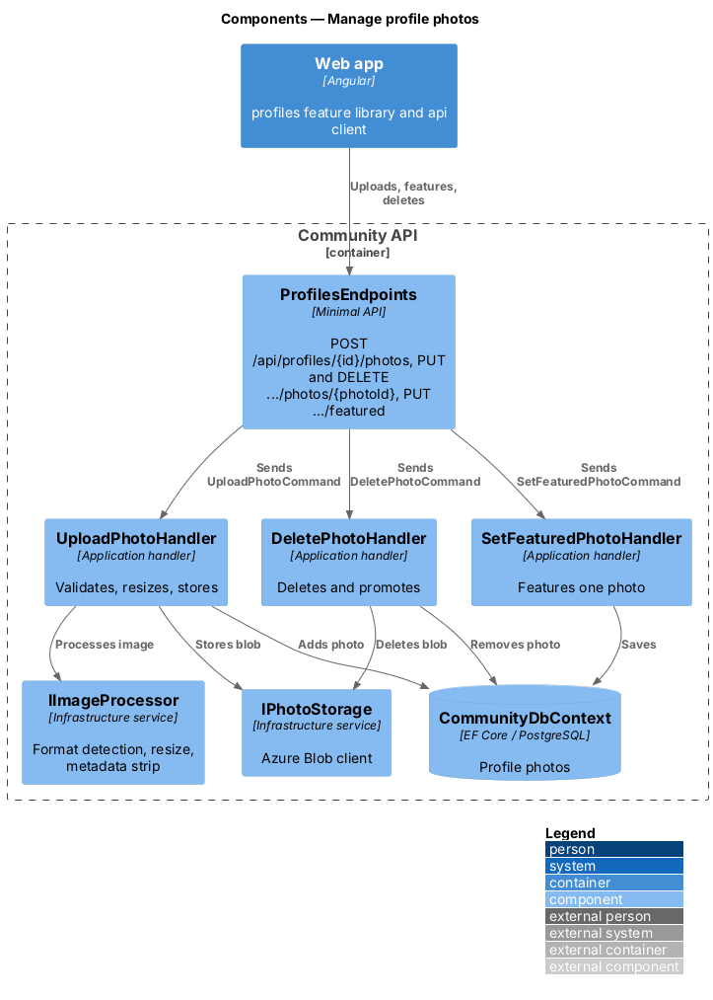
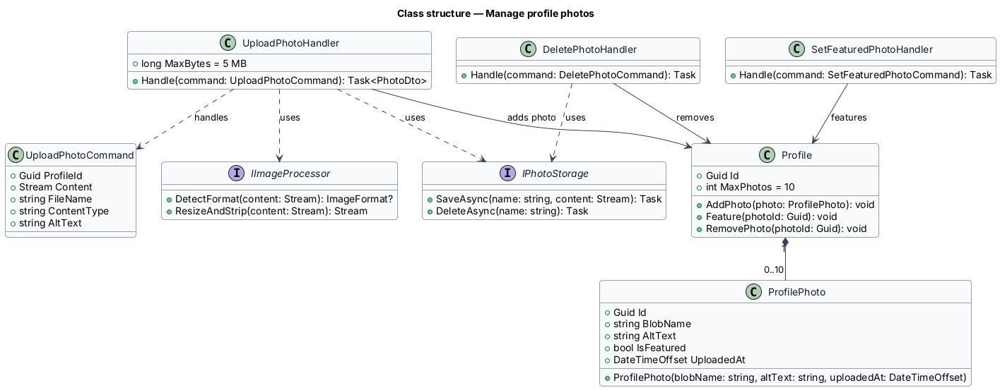
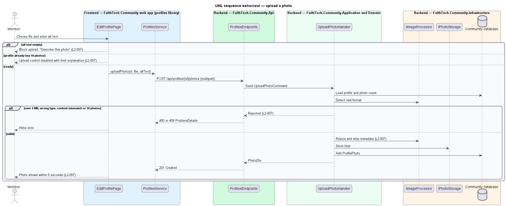
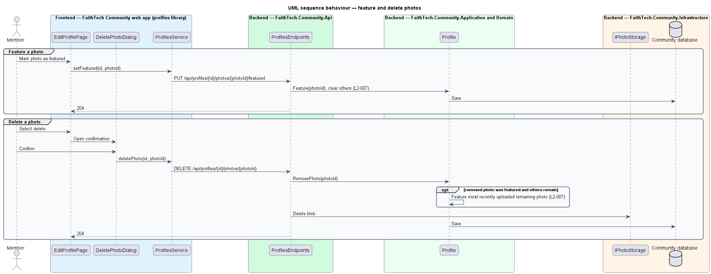

# Manage profile photos

## Overview

A profile may hold up to ten photos, exactly one of them featured as the avatar. *Manage profile photos* covers uploading, featuring and deleting those photos.

**alt text** — short text description of a photo read by screen readers; required for every photo

**metadata stripping** — removal of EXIF and other embedded data, including location, before storage

Uploads accept JPEG, PNG or WebP files of 5 MB or less whose content matches their extension. The server resizes each image and stores it in Azure Blob Storage. When the featured photo is deleted, the most recently uploaded remaining photo becomes featured.

## Description

- **`EditProfilePage`** photo section — part of the `profiles` feature library, matching the `edit-profile` mock. It uses `PictureListComponent`, which checks type and size in the browser, disables *Add photos* at 10 photos and explains the limit. A chosen file appears as a *pending* photo (not saved yet, no *Feature* action) with an empty description; *Save profile* uploads each pending photo and saves changed descriptions. A missing description blocks the save with "Describe this photo" in the error summary. *Feature* acts at once.
- **`DeletePhotoDialog`** — opened through `DialogService` from a saved photo's *Remove* button, matching the `delete-photo` mock (default, busy, failed). It calls `deletePhoto` and closes with the updated profile. A pending photo is removed without a dialog because nothing is stored yet.
- **`ProfilesService`** — contract in the `api` library, provided through the `PROFILES_SERVICE` injection token and implemented by `HttpProfilesService`.
- **`ProfilesEndpoints`** — minimal API route group in `FaithTech.Community.Api` under `/api/profiles`. Its endpoints require authentication by default and hold no business logic.
- **`ICurrentUser`** — Application abstraction exposing the caller's user id and roles; **`ProfileAccess`** decides owner, audited System Admin or 403 (ADR 0004).
- **`Profile`** — Domain entity holding `Name`, `Roles` and the `Photos` collection.
- **`UploadPhotoCommand`** / **`UploadPhotoHandler`** — `POST /api/profiles/{id}/photos`, multipart fields `file` and `altText`, answering `201` with the `PhotoDto`. The handler checks permission, the 10-photo limit, alt text ("Describe this photo."), size (5 MB) and content against extension, answering `400` keyed `File` or `AltText` so each shows inline, then resizes, strips metadata, stores the blob under `profiles/{profileId}/{blobId}.{ext}` and adds a `ProfilePhoto`. The first photo becomes featured.
- **`DescribePhotoCommand`** / **`DescribePhotoHandler`** — `PUT /api/profiles/{id}/photos/{photoId}` with `{ altText }` changes a photo's alt text through `ProfilePhoto.Describe` (L2-007 AC7).
- **`SetFeaturedPhotoCommand`** / **`SetFeaturedPhotoHandler`** — `PUT /api/profiles/{id}/photos/{photoId}/featured`; make one photo the only featured photo through `Profile.Feature`.
- **`DeletePhotoCommand`** / **`DeletePhotoHandler`** — `DELETE /api/profiles/{id}/photos/{photoId}`; remove the photo and its blob; `Profile.RemovePhoto` promotes the most recent remaining photo when the featured one is removed. Every write answers `403` to anyone but the owner or System Admin, whose override is audited.
- **`IImageProcessor`** — Application abstraction implemented with SkiaSharp in Infrastructure (`SkiaImageProcessor`): detects the real format from the bytes, applies the EXIF orientation, resizes to fit 1600 × 1600 without upscaling and re-encodes from pixels so no EXIF, XMP or IPTC metadata survives (ADR 0001).
- **`IPhotoStorage`** — Application abstraction implemented over Azure Blob Storage in Infrastructure: save, delete and one-hour read SAS URLs (ADR 0002). Tests use an in-memory fake.

## Requirements

The feature realizes the following level-2 (L2) requirements. Each L2 requirement refines a level-1 (L1) requirement, cited by identifier.

| L2 ID | Refines (L1) | Requirement |
|-------|--------------|-------------|
| `L2-007` | `L1-002` | Profile photos |

### Acceptance criteria

**`L2-007`**

1. Given a JPEG, PNG or WebP file of 5 MB or less with alt text, when the user uploads it, then it is resized on the server, stored in blob storage with metadata removed, and shown on the profile within 5 seconds.
2. Given a file larger than 5 MB, of another type, or whose content does not match its extension, when the user uploads it, then it is rejected with an inline error.
3. Given empty alt text, when the user uploads, then the upload is blocked with "Describe this photo".
4. Given a profile with 10 photos, when the user tries to add another, then the upload control is disabled and explains the limit, and the API rejects the upload.
5. Given several photos, when the user marks one as featured, then it becomes the only featured photo.
6. Given the featured photo is deleted after confirmation, when other photos remain, then the most recently uploaded remaining photo becomes featured.
7. Given an uploaded photo, when the owner changes its description to non-empty text and saves, then the new alt text is stored; an empty description is blocked with "Describe this photo".

## Diagrams

### System context

Members manage their own photos in FaithTech Community. Photo storage is part of the system, shown at container level.

### Containers

The web app uploads multipart files to the Community API, which stores images in Photo storage and photo records in the Community database.

### Components

`ProfilesEndpoints` dispatches photo commands to their handlers. `UploadPhotoHandler` uses `IImageProcessor` and `IPhotoStorage`. Featuring and deleting change the `Profile` aggregate.

### Class structure

`Profile` composes up to 10 `ProfilePhoto` items and enforces the single-featured rule. The handlers depend on `IImageProcessor` and `IPhotoStorage`.

### Behaviour — upload a photo

The page blocks missing alt text and the eleventh photo. The handler re-checks every rule, then resizes, strips metadata and stores the image (`L2-007`).

### Behaviour — feature and delete photos

Featuring clears every other featured flag. Deleting the featured photo after confirmation promotes the most recently uploaded remaining photo (`L2-007`).

## Open questions

Decisions recorded while building the Domain layer (`FaithTech.Community.Domain`):

- `ProfilePhoto` rejects empty alt text; `Profile.AddPhoto` rejects an eleventh photo and features the first; `Profile.Feature` and `Profile.RemovePhoto` reject an unknown photo id. Domain rule violations throw `InvalidOperationException` (a broken rule) or `ArgumentException` (invalid input); there is no shared domain exception type. Handlers check permissions and preconditions first and map any remaining violation to a `400` or `409` result.
- Photos persist in a `ProfilePhotos` table owned by `Profiles`.

Decisions recorded while implementing the feature:

- The edit-profile mock lets every photo's description be edited, which L2-007 did not cover. AC7 is added to L2-007 and `PUT /api/profiles/{id}/photos/{photoId}` implements it. Resolved.
- Image processing uses SkiaSharp, 1600 px maximum (ADR 0001); storage, keys and SAS read URLs follow ADR 0002. Resolved.
- Uploads are sent when the member saves, one request per pending photo, so alt text is always present at upload (AC3). Progress percentages are not reported, so the photo shows "Uploading…" with no bar. `PhotoComponent` shows a `ProgressComponent` bar ("Uploading photo N") above the status line whenever a percentage is supplied, so reporting one later needs no UI change. Resolved. While a photo uploads, `aria-busy` sits on the `PhotoComponent` item that holds the thumbnail and its status line, not on the thumbnail alone. Resolved.
- Requests up to 10 MB are read so that a too-large photo gets the inline `400` error rather than a bare `413`. Resolved.
- Reordering photos is not in L2-007 and is not built.
