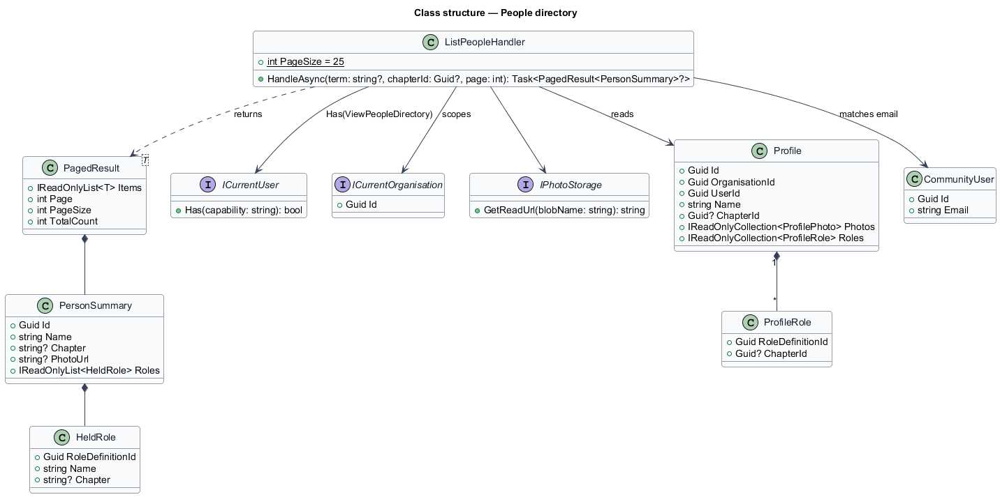
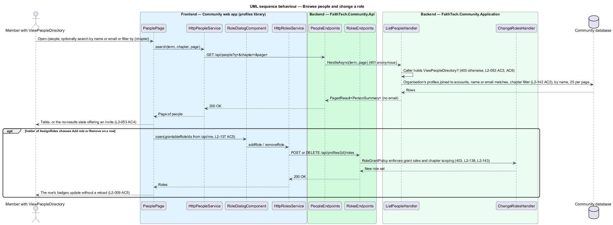

# People directory

## Overview

The **people directory** — the *People and roles* page at `/people`, where holders of `ViewPeopleDirectory` (seeded as City Lead, Staff and System Admin in FaithTech) find any member of the organisation by name or email and see their photo, roles, each with its {chapter} tag, and home {chapter}. Holders of `AssignRoles` also add and remove roles from a member's row, within their grant rules (`L2-137`, `L2-138`) and chapter scoping (`L2-143`); a holder of `ViewPeopleDirectory` without `AssignRoles` sees the same list read-only. Every other member gets a forbidden page, and anonymous visitors are sent to sign in. When the organisation has chapters, a {chapter} filter offers "All {Chapters}" and the active chapters (`L2-142`).

**member** — any signed-in account with a profile, whatever roles it holds

The directory is not the administrator users page (`docs/detailed-designs/admin/admin-users-and-override`): it never returns email addresses or account status, and it has its own endpoint, so a holder of `ViewPeopleDirectory` gains no access to administrative data.

## Description

- **`PeoplePage`** — page at `/people` in the `profiles` feature library, matching the `people` mocks (default, admin, read-only, loading, error, no-results, forbidden). It composes `PageHeaderComponent` ("People and roles" with a subtitle by capability, and for holders of `InviteMembers` *Invite someone*, a link to `/invites` because `profiles` cannot depend on `invites`), a search form with `TextFieldComponent` (`type="search"`, "Search people", placeholder "Search members by name or email") and, when chapters are on, a {chapter} `SelectComponent` filter listing "All {Chapters}" and the active chapters from `GET /api/organisation` (`L2-142` AC1), `TableComponent` (caption "Members and their roles": Member with `AvatarComponent` `sm` showing the featured photo and a `LinkComponent` to `/people/:id`, Roles as `BadgeComponent` `role` reading "{role} · {chapter}" when tagged (`L2-141` AC3) or "No role yet", {Chapter} (the home {chapter}, omitted when chapters are off), and a visually hidden Actions column), `ListSkeletonComponent` (5 rows, "Loading people"), `EmptyStateComponent` for the error, no-results and forbidden states and *Show more people* when more pages exist.
- **Row actions** — *Add role* (`ButtonComponent`, `object` = the member's name) when `grantableRoleIds` from `/api/me` holds a role the member does not hold (`L2-137` AC5), *Remove* (`ghost`) when the member holds a role in `grantableRoleIds` whose {chapter} tag the caller's scoping allows (`L2-143`), and the caption "Only an administrator can change" when the member holds only roles outside the caller's grant rules. Both actions open the shared `RoleDialogComponent` (ADR 0005) through `DialogService` and call `ROLES_SERVICE`; the row's badges update from the returned role set without a reload (`L2-009` AC5). The role-dialog wiring is shared with `ProfilePage` inside the `profiles` library (`role-actions.ts`).
- **`PeopleService`** / **`PEOPLE_SERVICE`** / **`HttpPeopleService`** — contract, injection token and HTTP client in `api` calling `GET /api/people?q=&chapter=&page=`. The client marks the call `HANDLES_FORBIDDEN` so the page shows its own forbidden state.
- **`PeopleEndpoints`** — minimal API mapping of `GET /api/people` in `FaithTech.Community.Api`; authentication is required (`401` anonymous) and it only dispatches. A `null` result from the handler answers `403`.
- **`ListPeopleHandler`** — Application handler in `Profiles/`. It returns `null` unless `ICurrentUser.Has(Capability.ViewPeopleDirectory)`, then joins the organisation's profiles to their accounts, matches the trimmed term case-insensitively against name or email, applies the optional `chapter=` filter (`L2-142` AC2), orders by name then id and returns 25 per page. Every query is scoped by the DbContext's global filter on `ICurrentOrganisation`.
- **`PersonSummary`** — `Id` (profile id), `Name`, `Chapter` (the home {chapter} name or `null`), `PhotoUrl` (the featured photo's read URL or `null`) and `Roles` (every role held: definition id, name and {chapter} tag, `L2-141` AC3). Email is matched, never returned.

## Requirements

The feature realizes the following level-2 (L2) requirements. Each L2 requirement refines a level-1 (L1) requirement, cited by identifier.

| L2 ID | Refines (L1) | Requirement |
|-------|--------------|-------------|
| `L2-053` | `L1-003` | People directory and role management |
| `L2-009` | `L1-003` | Role assignment limits (actions on each row) |
| `L2-005` | `L1-002` | Profile visibility (sign-in required, avatar colour) |
| `L2-142` | `L1-027`, `L1-007`, `L1-008`, `L1-024` | Chapter filters |

### Acceptance criteria

**`L2-053` — People directory and role management**

1. Given a holder of `ViewPeopleDirectory`, when they open people, then all members of the organisation are listed with their roles, each with its {chapter} tag when it has one, and home {chapter}, with search and a {chapter} filter when chapters are on (`L2-142` AC1).
2. Given a holder of `AssignRoles`, when they view people, then the add-role and remove-role actions follow L2-009, offering only the roles their grant rules allow (`L2-137` AC5) and the chapters their scoping allows (`L2-143`); a holder of `ViewPeopleDirectory` without `AssignRoles` sees the list read-only.
3. Given a member without `ViewPeopleDirectory`, when they open people, then a forbidden page is shown.
4. Given a search with no matches, when it completes, then an empty state offers to send an invite to a holder of `InviteMembers`, and otherwise says to ask someone who can send invites.
5. Given a holder of `ViewPeopleDirectory`, when they search people by name or email, then matching members are listed 25 at a time by name with their photo, roles and home {chapter}, and a member's email is never shown.
6. Given an anonymous visitor, when they request the people page or the people API, then they are redirected to sign in (page) or receive 401 (API); any other signed-in caller of the people API receives 403 and no member data.

**`L2-009`** AC1–AC6 apply to the row actions; the server's `RoleGrantPolicy` stays the authority (`L2-138`, `L2-143`).

**`L2-142` — Chapter filters**

1. Given chapters are on, when the team list (`L2-019`), the event list (`L2-021`), People (`L2-053`) and Reports (`L2-124`) render their filter, then it offers "All {Chapters}" and the active chapters in order, from `GET /api/organisation`, in place of the former distinct-city lists, and the URL carries `chapter=` in place of `city=`.
2. Given a chapter filter, when it is applied, then only records tagged with that chapter are listed, and an event with no chapter appears only under "All {Chapters}" and under "{Organisation}-wide" when that option is offered (events only).
3. Given chapters are off, when those pages render, then the filter is absent and the lists are organisation-wide.
4. Given a people picker or share picker that shows a person's role and city (`L2-056` AC4, `L2-061` AC1, `L2-064` AC3, `L2-093` AC2), when it renders, then it shows "{name} · {role} · {chapter}", omitting what is missing.
5. Given an empty result for a chapter, when the list renders, then the empty state names the chapter ("No upcoming events in Toronto").

## Diagrams

### Class structure

`ListPeopleHandler` checks `ViewPeopleDirectory`, reads `Profile` with its account's email for matching and returns `PersonSummary` pages.

### Behaviour — browse people and change a role

The handler refuses anyone without `ViewPeopleDirectory`. A row's role change goes through the existing roles endpoints and `RoleGrantPolicy`, then updates the row in place.

## Open questions

Decisions recorded while implementing the feature:

- The directory has its own endpoint and DTO instead of reusing `GET /api/admin/users`, which stays `AdministerOrganisation` only and returns email and status. Resolved.
- Paging: 25 per page by name with *Show more people*, like the admin users page; the mocks show one page. Resolved.
- Suspended accounts stay listed, as on the team list; hiding them is deferred to the admin subsystem. Resolved.
- The mock's row for a member holding ungrantable roles showed only the caption; `L2-009` lets a grantor add a grantable role to anyone, so the row offers *Add role* beside that caption. The mocks were aligned. Resolved.
- The forbidden mock named a specific member; the app cannot know whom to name, so it says to ask someone who can assign roles. The mock was aligned. Resolved.
- Capabilities: access was decided by role name and the row actions by `RoleAssignmentPolicy`; the page now opens on `ViewPeopleDirectory`, acts on `AssignRoles` with `grantableRoleIds`, and filters by {chapter} (ADR 0033, ADR 0034).
- *Invite someone* links to `/invites`, as on the team page (ADR 0007), because `profiles` cannot open the invites library’s dialog; the mocks’ separate *Invites* button went to the same page, so it was dropped from the mocks. Resolved.
