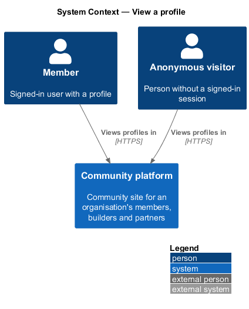
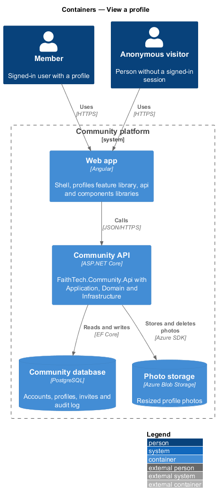
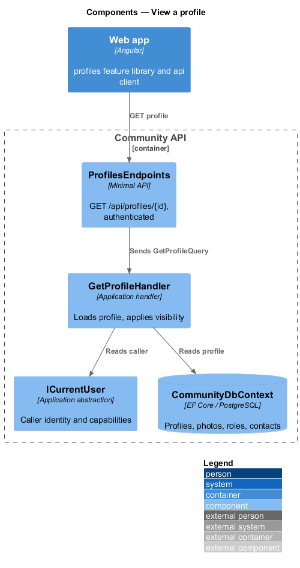
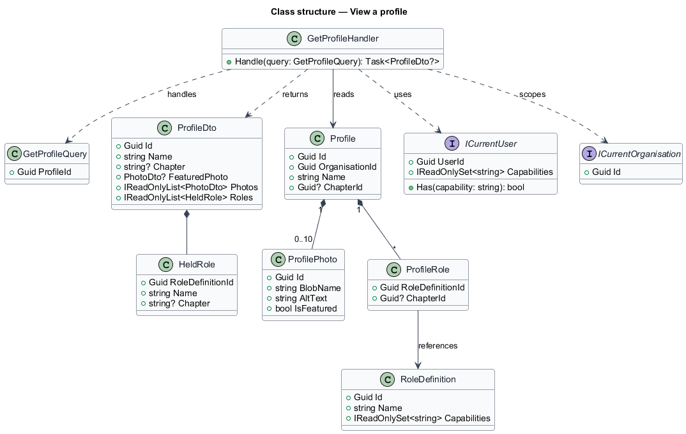
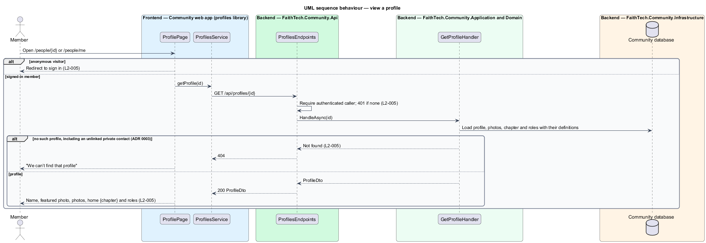

# View a profile

## Overview

A *profile* is the public face of an account inside the community: a name, up to ten photos with one featured, a home {chapter}, and the roles the person holds. Profiles exist so that members can recognise each other across events, teams and partners.

**featured photo** — the single photo shown as a profile's avatar

**member** — any signed-in user, whatever roles the profile holds

Profiles are visible to signed-in members only. An anonymous visitor who requests a profile page is redirected to sign in, and the profile API returns 401. A private contact is not a profile: until a contact is linked to a real account, any request for it as a profile returns 404 to everyone except its owner and a holder of `AdministerOrganisation`.

## Description

- **`ProfilePage`** — page in the `profiles` feature library at `/people/:id` (and `/people/me` for the caller's own profile), matching the `profile` mock. It composes `ProfileHeaderComponent` (featured photo or initials, name, role badges reading "{role} · {chapter}" when tagged (`L2-141` AC3), home {chapter}, bio, photo strip), `EmptyStateComponent` for the no-photos and load-error states and `ButtonComponent` for *Edit profile* on the caller's own profile. While the profile loads, `ProfileHeaderComponent` shows a busy skeleton head (avatar, title and text) followed by a photo strip of four square `SkeletonComponent` tiles (`shape="square"`), so the photo area keeps the shape of the photos it is waiting for (`profile/loading` mock).
- **`authGuard`** — app-shell route guard that redirects anonymous visitors to sign in before the `profiles` library loads.
- **`ProfilesService`** — contract in the `api` library, provided through the `PROFILES_SERVICE` injection token and implemented by `HttpProfilesService`.
- **`ProfilesEndpoints`** — minimal API route group in `FaithTech.Community.Api` under `/api/profiles`. Its endpoints require authentication by default and hold no business logic.
- **`ICurrentUser`** — Application abstraction exposing the caller's user id and capabilities. The caller's profile in `ICurrentOrganisation` is found by `Profile.UserId` through `ProfileAccess` (ADR 0004, ADR 0032). Every query is scoped by the DbContext's global filter on `ICurrentOrganisation`.
- **`Profile`** — Domain entity holding `Name`, `ChapterId`, `Roles` (each a `RoleDefinition` reference with an optional {chapter}) and the `Photos` collection.
- **`GetProfileHandler`** — Application handler for `GET /api/profiles/{id}` and `GET /api/profiles/me`. It loads the profile with photos and roles and returns a `ProfileDto`, or not-found. It reads only profiles, so an unlinked private contact is never found (ADR 0003).
- **`ProfileDto`** — response contract: `Id`, `Name`, `Chapter` (the home {chapter} name or `null`), `Bio`, `FeaturedPhoto`, `Photos` (`Id`, `Url`, `AltText`, `IsFeatured`, `UploadedAt`, newest first), `Roles` (definition id, name and {chapter} tag), `IsOwn` (the caller's own profile) and `CanEdit` (owner or holder of `AdministerOrganisation`).
- **`avatarColorFor`** — pure function in the `components` library that maps a profile id onto one of the seven avatar colours (ADR 0008). `ProfilePage` passes `avatarColorFor(profile.id)` to the header, the app shell passes the caller's `profileId` from `GET /api/me`, and the admin users table passes each row's id (plain for a suspended account), so a member's colour is the same on every screen.
- **Photo URLs** — read-only SAS URLs into the private `profile-photos` container that expire after one hour, generated by `IPhotoStorage.GetReadUrl` (ADR 0002).

## Requirements

The feature realizes the following level-2 (L2) requirements. Each L2 requirement refines a level-1 (L1) requirement, cited by identifier.

| L2 ID | Refines (L1) | Requirement |
|-------|--------------|-------------|
| `L2-005` | `L1-002` | Profile visibility, including a member's avatar colour (AC4) |
| `L2-141` | `L1-027`, `L1-002`, `L1-008` | Chapters on profiles, events and role assignments |

### Acceptance criteria

**`L2-005` — Profile visibility**

1. Given an anonymous visitor, when they request any profile page or profile API, then they are redirected to sign in (page) or receive 401 (API).
2. Given a signed-in member, when they open another member's profile, then they see the name, featured photo, photos, home {chapter} (`L2-141` AC1) and roles, each role with its {chapter} tag when it has one (`L2-141` AC3).
3. Given a private contact that has not been linked, when any user other than its owner or a holder of `AdministerOrganisation` requests it as a profile, then the response is 404.
4. Given a member's avatar on any screen, when it renders, then its colour is derived from the member's profile id and is the same on every screen (the top bar, the profile, tables); a private contact who has not signed up, and a suspended member (`L2-039`), show the plain avatar.

**`L2-141` — Chapters on profiles, events and role assignments**

1. Given chapters are on, when a member edits their profile (`L2-006`), then "Home {chapter}" is an optional picker of the active chapters (plus the member's current one if archived) in place of the former free-text home city; the profile page and person cards show it.
2. Given chapters are on, when an event is created or edited (`L2-020`), then "{Chapter}" is an optional picker of the active chapters; none means organisation-wide, shown as "{Organisation}-wide"; the event list, event page, public page, `.ics` location line and Home show the chapter name.
3. Given a role assignment on a chapter-scopable definition (`L2-138` AC6), when it is shown as a badge on a profile, in People, on the team list or on the connect page, then it reads "{role} · {chapter}", or "{role}" when untagged.
4. Given a contact (`L2-013`), when it is created or edited, then its city stays a free-text field labelled "City", whatever the chapter label, because a contact is an outsider.
5. Given a partner, when it is shown or counted, then it has no chapter of its own; reports attribute it to its owner's home chapter (`L2-125`).
6. Given the FaithTech migration, when it runs, then one chapter per distinct trimmed, case-folded former home city and event city value is created with the label City/Cities, exact matches are mapped, unmatched values are set to none and written to the migration log, and running it again changes nothing.

## Diagrams

### System context

Members view profiles in the Community platform. Anonymous visitors are refused.

### Containers

The web app requests a profile from the Community API, which reads it from the Community database. Photo images come from Photo storage.

### Components

`ProfilesEndpoints` requires authentication and forwards a `GetProfileQuery` to `GetProfileHandler`, which applies the private-contact rule before reading.

### Class structure

`GetProfileHandler` reads `Profile` with its `ProfilePhoto` collection and `ProfileRole` set, each referencing a `RoleDefinition`, and maps it to `ProfileDto`.

### Behaviour — view a profile

The guard and the endpoint refuse anonymous callers. The handler hides unlinked private contacts behind a 404 and returns the name, photos, home {chapter} and roles to every other member (`L2-005`).

## Open questions

Decisions recorded while implementing the feature:

- The access form of photo URLs is a one-hour read-only SAS URL (ADR 0002). Resolved.
- An unlinked private contact is never resolvable through the profile API, so every caller, its owner and administrators included, gets 404 there; they read the contact through the contacts API (ADR 0003). Resolved.
- The avatar colour is derived from the profile id rather than stored, so members cannot choose it (ADR 0008). Resolved.
- The mock's "Member since March 2024" needs a join date the `Profile` entity does not store; it is not shown. Deferred.
- The mock's *Add a role* and *Message by email* actions belong to role management (L2-009) and contacts; they are not shown yet. Deferred.
- Capabilities and chapters: roles were enumeration names and the home city free text; roles are now `RoleDefinition` references with a {chapter} tag, and the home city is `Profile.ChapterId` (ADR 0033, ADR 0034).
