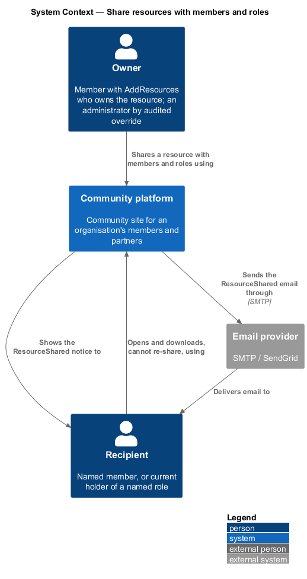
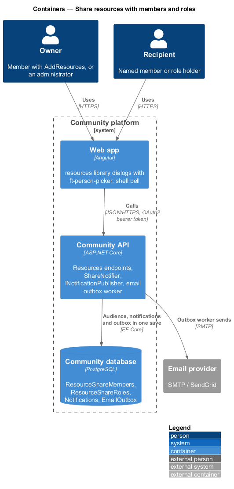
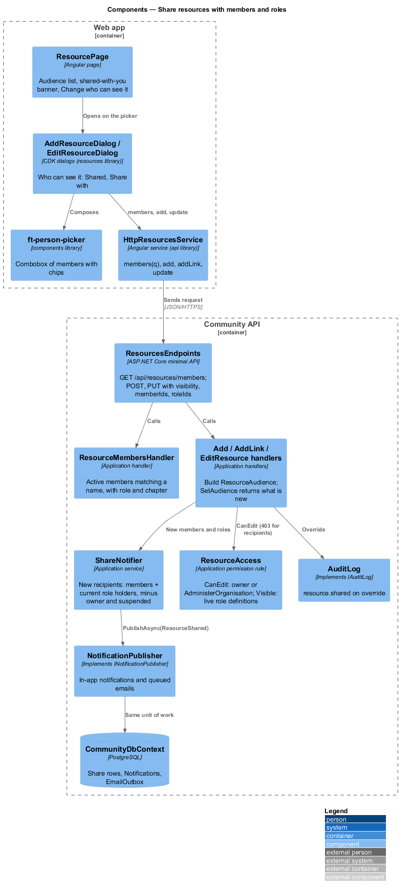
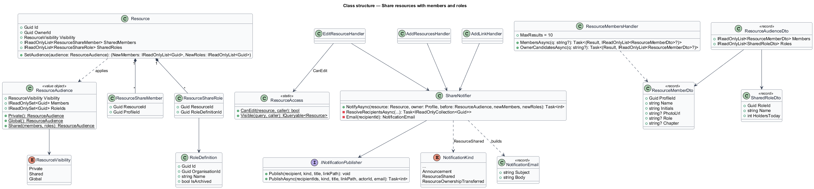
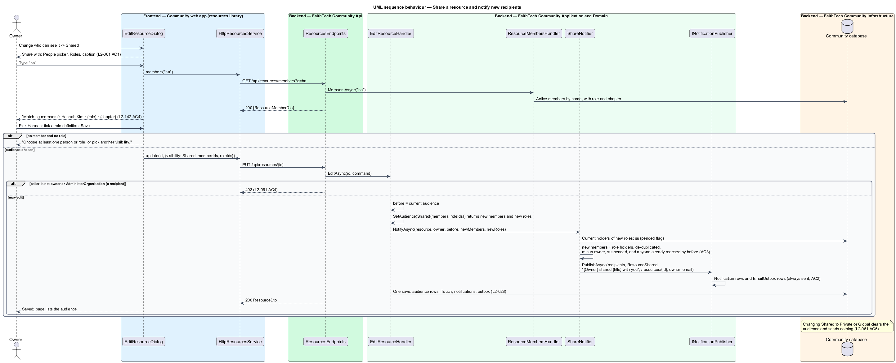
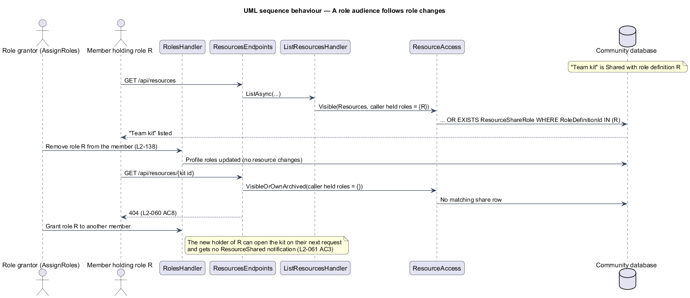

# Share resources with members and roles

## Overview

A **Shared** resource is visible to its owner, to the members it names and to whoever holds one of the role definitions it names, plus a holder of `AdministerOrganisation`. Sharing is the Shared choice of the "Who can see it" picker in the add and edit dialogs; there is no separate share dialog. Everyone newly reached by a share gets a `ResourceShared` notification in-app and by email, in the same save as the share.

Key terms:

- **audience** — the named members (`ResourceShareMember`) and named roles (`ResourceShareRole`, each a reference to one of the organisation's non-archived `RoleDefinition`s, `L2-136`) of a Shared resource, held as the `ResourceAudience` value object
- **live role audience** — a role in the audience is evaluated against the caller's current roles on every request; whoever holds the role now may open the resource (`L2-060` AC8, ADR 0017)
- **recipients** — the members notified at save time: each named member plus every current holder of each named role, de-duplicated, excluding the owner and suspended members; a later audience change notifies only recipients who were not in the previous audience
- **no re-share** — a recipient can open and download the resource but cannot change its audience; only the owner and a holder of `AdministerOrganisation` can

Visibility enforcement for Shared resources (`ResourceAccess.Visible`) is described in `resources/list-and-find`; the dialogs that host the picker are in `resources/add-and-edit`.

## Description

### Web app

- **"Share with" section** — part of `AddResourceDialog` and `EditResourceDialog` (mock `dialogs/add-resource/shared`), shown when Shared is chosen in the `ft-radio-group` "Who can see it". It holds an `ft-person-picker` labelled "People" in multiple mode (placeholder "Search members by name"; suggestions in a listbox "Matching members" show an `ft-avatar` and "{name} · {role} · {chapter}", omitting what is missing (`L2-142` AC4); chosen members are removable chips "Remove {name}"), an `ft-checkbox-group` "Roles" listing the organisation's non-archived role definitions from `GET /api/organisation` (`L2-136`), live, so a role defined today can be shared with today and the caption "Everyone you add gets a notification. They can open and download it, but can’t share it on." The submit reads *Add and share* on add. With no member and no role, submitting shows "Choose at least one person or role, or pick another visibility." on the picker and in the error summary.
- **"Change who can see it"** — on `ResourcePage` for the owner and a holder of `AdministerOrganisation` of a Shared resource; it opens `EditResourceDialog` with focus on the visibility picker (`L2-061` AC5).
- **`ResourcePage` audience** — the Details list shows "Shared — the people and roles below", then each role as "Everyone with the {role} role · Role · N people today" and each member as "Member · {chapter}" with an avatar (omitted when the member has none or chapters are off, `L2-142` AC4), and the note "People you share with can open and download it, but can’t share it on." A recipient sees the banner "{Owner} shared this with {you | everyone who has the {role} role}. You can open and download it, but not share it on." and no edit, share or archive control (mock `pages/resource/shared`, `shared-with-you`).
- **Bell and email** — the `ResourceShared` notice "{Owner} shared {title} with you" links to `/resources/{id}` through the existing `NoticeListComponent` (mock `notifications/bell/resource-shared`); the email follows the `.email` pattern (mock `notifications/email/resource-shared`).
- **`HttpResourcesService.members(q)`** — calls `GET /api/resources/members?q=` for the people picker; `add`, `addLink` and `update` carry `visibility`, `memberIds` and `roleIds`.
- **Components** — new `PersonPickerComponent` `ft-person-picker` in `components` (design system `components/person-picker.html`): an APG combobox with list autocomplete over people, removable chips in multiple mode or one chosen person in single mode, `loading` and `empty` notes, error and disabled states. It takes the suggestions as an input and emits the query, so it makes no HTTP calls. `TagInputComponent` and `PersonPickerComponent` share the chip-in-field look (`.tag-input`) from the design system.

### Community API

- **`ResourcesEndpoints`** — `GET /api/resources/members?q=` answers up to 10 `ResourceMemberDto` (`profileId`, `name`, `initials`, `photoUrl`, `role`, `chapter`) for a holder of `AddResources` (`403` otherwise); add, add link and edit accept `visibility`, `memberIds` and `roleIds`.
- **`ResourceMembersHandler`** — `MembersAsync(q)`: active, verified members (not suspended) whose name matches, excluding the caller, with a held role name and home chapter (`Profile.ChapterId`) for the suggestion line. `OwnerCandidatesAsync(q)` (`AdministerOrganisation` only) is the same list restricted to members whose roles carry `AddResources`, used by ownership transfer (`resources/archive-and-transfer`).
- **`ResourceAudience`** — Domain value object: `Private()`, `Global()` or `Shared(members, roles)`; `Shared` with no member and no role is refused. Built from the request by the handlers after `ResourceFieldRules` checks that every role id is a non-archived `RoleDefinition` of the organisation and every member id is an active member of the organisation (`400` otherwise, `L2-061` AC1).
- **`Resource.SetAudience(audience)`** — replaces the `ResourceShareMember` and `ResourceShareRole` rows and returns the members and role ids that were **not** in the previous audience. Changing to Private or Global clears the audience (`L2-061` AC6).
- **`ShareNotifier`** — Application service in `Resources/` called by `AddResourcesHandler`, `AddLinkHandler` and `EditResourceHandler` before their one save. It resolves the new recipients: the new members plus the current holders of the new roles (a query on profile roles), de-duplicated, minus the owner, minus suspended members, minus anyone who already had access through the previous audience. It then calls `INotificationPublisher.PublishAsync(recipients, NotificationKind.ResourceShared, "{Owner} shared {title} with you", "/resources/{id}", ownerId, email)` where the email is subject "{Owner} shared {title} with you", heading "A resource was shared with you", body "{Owner} shared “{title}” ({Type}, {EXT}, {size}) with {you | everyone who has the {role} role, which includes you}." and the button "Open the resource". `ResourceShared` is an activity email, not an announcement, so the announcement opt-out does not apply (`L2-061` AC2). The notifications and queued emails join the same unit of work as the resource, so the share and its notifications commit together (`L2-028`).
- **Re-share refused** — a recipient is not the owner, so `ResourceAccess.CanEdit` is false and `PUT /api/resources/{id}` answers `403` (`L2-061` AC4). An `AdministerOrganisation` override changing someone else's audience is audited as `resource.shared` with the before and after audience (`L2-135` AC5).
- **Live roles** — no snapshot of role holders is stored. `ResourceAccess.Visible` joins `ResourceShareRoles` against the caller's held role definition ids from `ICurrentUser`, so a member who gains a role sees the resource on their next request without a notification, and one who loses it does not (`L2-061` AC3, `L2-060` AC8).

## Requirements

The feature realizes the following level-2 (L2) requirements. Each L2 requirement refines a level-1 (L1) requirement, cited by identifier.

| L2 ID | Refines (L1) | Requirement |
|-------|--------------|-------------|
| `L2-061` | `L1-020` | Share with members and roles |
| `L2-136` | `L1-026`, `L1-028` | Role definitions |

The `ResourceShared` kind also extends the notification sources of `L2-027` (in-app) and `L2-028` (email).

### Acceptance criteria

**`L2-061` — Share with members and roles**

1. Given Shared is chosen in the add or edit dialog, when the form renders, then a "Share with" section offers a people picker ("Search members by name", suggestions show "{name} · {role} · {chapter}", `L2-142` AC4, chosen members appear as removable chips) and a checkbox group of the organisation's non-archived role definitions (`L2-136`), with "Everyone you add gets a notification. They can open and download it, but can’t share it on.", and the submit reads "Add and share"; a role id that is archived or belongs to another organisation answers 400.
2. Given a resource is saved as Shared, when the save completes, then every recipient (each named member plus every current holder of each named role, de-duplicated, excluding the owner and suspended members) gets the in-app notification "{Owner} shared {title} with you", linking to the resource, and an email with the subject "{Owner} shared {title} with you", the heading "A resource was shared with you", the body "{Owner} shared “{title}” ({Type}, {EXT}, {size}) with {you | everyone who has the {role} role, which includes you}." and the button "Open the resource", in the same save (`L2-028`); this email cannot be turned off.
3. Given the audience of a Shared resource is changed, when the save completes, then only recipients who were not in the previous audience are notified; a member who gains a shared role later may open the resource at once (`L2-060` AC8) and gets no notification.
4. Given a member who may open a Shared resource but does not own it, when they view it, then no share, edit or archive control is rendered, and any attempt to change its audience through the API answers 403.
5. Given the audience section on the resource page, when the owner chooses "Change who can see it", then the edit dialog opens on the visibility picker (`L2-062`).
6. Given a Shared resource is changed to Global or Private, when the save completes, then the audience is cleared and no notification is sent.

**`L2-136` — Role definitions**

1. Given a holder of `ManageRoles` on the Roles page (`/organisation/roles`), when they choose "Define a role", then a dialog asks for a name (required, up to 60 characters, unique within the organisation ignoring case), a description (optional, up to 200), the capabilities (checkbox per catalogue entry with its description) and three switches: "Show on the team list", "Can be held for a {chapter}" (shown only when chapters are on, `L2-140`) and "Oversight role (shows a viewing-as banner)"; `POST /api/organisation/roles` saves it, a success toast confirms (`L2-054`), and an audit entry `role.defined` is written.
2. Given a definition, when the holder edits its name, description, capabilities or flags and saves, then `PUT /api/organisation/roles/{id}` applies the change, every holder's capabilities change on their next request (`L2-133` AC5), and `role.updated` records the before and after.
3. Given a name that is empty, too long or already used by a non-archived definition, when the dialog is saved, then the field shows an inline error, the API answers 400 with problem details (`L2-043` AC1), and nothing is saved.
4. Given a definition with holders, when the holder archives it, then the request is refused with 409 "{n} members hold this role. Remove it from them first."; given it is named by a grant rule, a share audience or an announcement audience, then 409 names what still uses it; given nothing uses it, then `POST /api/organisation/roles/{id}/archive` archives it, it leaves every picker, and `role.archived` is written.
5. Given a definition that carries `AdministerOrganisation`, when an edit would remove that capability, or an archive is attempted, and no other active, unsuspended member would be left holding `AdministerOrganisation`, then the request is refused with 409 "There must always be at least one administrator." (`L2-139`).
6. Given the Roles page, when it renders, then it lists the non-archived definitions in order with name, description, the number of holders, a capability summary and the flags, with an "Archived" filter to show archived ones read-only; the page follows `L2-044` and `L2-045`.
7. Given a holder of `ManageRoles` who does not hold `AdministerOrganisation`, when they add `AdministerOrganisation` to any definition, then the request is refused with 403 "Only an administrator can grant administration."
8. Given any member without `ManageRoles`, when they call any role-definition endpoint, then the response is 403; `GET /api/organisation` still lists the non-archived role names and ids for pickers.

## Diagrams

### System context

The owner shares a resource with members and roles; recipients are told in the app and by email through the email provider.

### Containers

The dialogs send the audience with the add or edit request. The API saves the audience, the in-app notifications and the queued emails in one transaction; the outbox worker sends the emails.

### Components

`ShareNotifier` resolves the new recipients and publishes through `INotificationPublisher`; `ResourceMembersHandler` feeds the people picker.

### Class structure

`ResourceAudience` is the value the handlers pass to `Resource.SetAudience`, which returns what is new. `ShareNotifier` turns that into recipients.

### Behaviour — share and notify

Saving a Shared resource stores the audience and notifies only the new recipients, in the same save.

### Behaviour — a role audience follows role changes

A role named in the audience is matched against the caller's roles on every request, so gaining or losing the role changes what they can open, with no change to the resource and no notification.

## Open questions

Decisions recorded for this design ([ADR 0017](../../../adr/0017-resources-storage-access-and-lifecycle.md)):

- A role in a Shared audience is live, not a snapshot: a shared resource is a standing permission, unlike an announcement, which is a message delivered once. Notifications are the only snapshot. Resolved.
- Sharing lives in the add and edit dialogs ("Who can see it" → Shared), and "Change who can see it" opens the edit dialog on the picker; the separate `share-resource` dialog named in the feature prompt was not drawn and is not built. Resolved.
- The role list offered the seven fixed roles of the former `L2-061` AC1, leaving out the roles with no capability and the administrator role (an administrator can always open every resource); superseded by the Capabilities bullet below. Resolved.
- `ResourceShared` emails are activity emails and are always sent; the announcement opt-out does not cover them. Resolved.
- Capabilities: the fixed role list is replaced by the organisation's non-archived role definitions, referenced by id and read live; the owner-candidate list is every member holding `AddResources` (ADR 0033).
