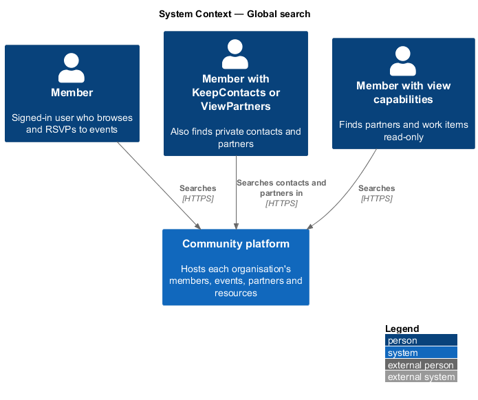
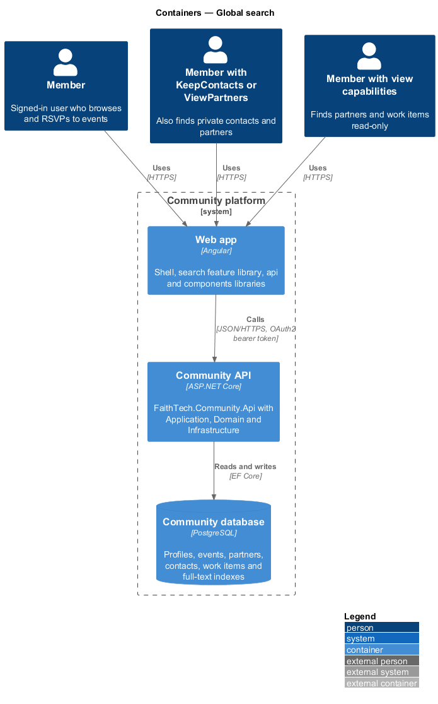
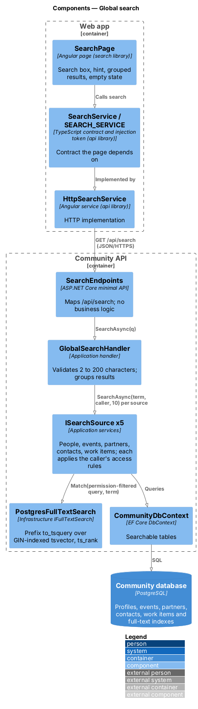
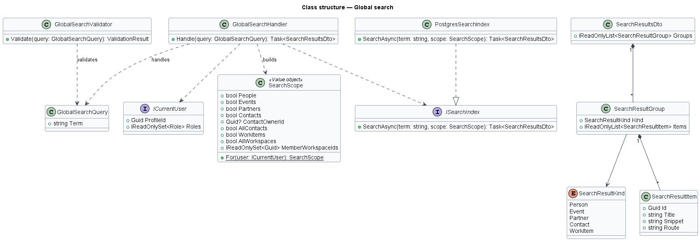
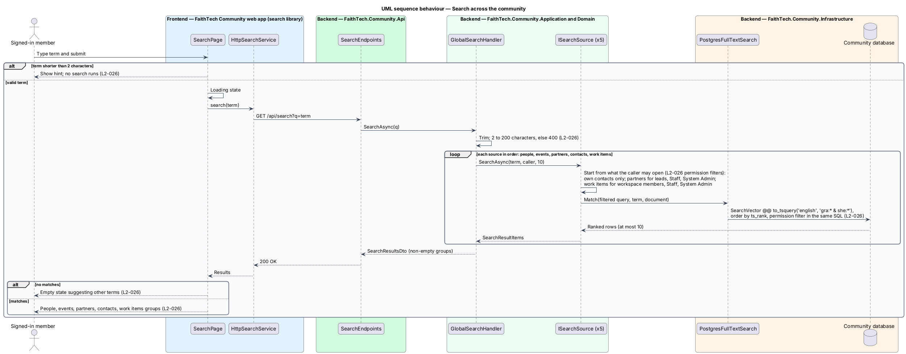

# Global search

## Overview

FaithTech Community holds people, events, partners, private contacts and Agile work items. Global search lets a signed-in member find any of them from one search box, with results grouped by kind.

Key terms:

- **full-text search** — PostgreSQL text search using `tsvector` documents and `tsquery` queries, ranked by relevance
- **search document** — `tsvector` value built from the searchable fields of one record
- **result group** — set of results of one kind: people, events, partners, contacts or work items

Search never widens what a user may open. The server filters every group by permission before results leave the API: a caller sees only their own private contacts (System Admin sees all), partners only when the caller is a lead, Staff or System Admin, and work items only for workspace members, Staff and System Admin.

## Description

- **`SearchPage`** — routed page in the `search` feature library (mock: `docs/mocks/pages/search/`, states `default`, `loading`, `empty`, `error`). It shows the minimum-length hint, grouped results and an empty state that suggests other terms. It composes the search input and result list from `components`.
- **`SearchService` / `SEARCH_SERVICE`** — API client contract and token in the `api` library; `HttpSearchService.search(term)` calls the API.
- **`SearchEndpoints`** — maps `GET /api/search?q=` with authentication required.
- **`GlobalSearchQuery`** — query carrying the term.
- **`GlobalSearchHandler`** — Application handler that trims the term, answers `400` under 2 characters so no search runs (`L2-026`), resolves the caller's permissions from `ICurrentUser` into a `SearchScope`, and asks every registered `ISearchSource`, leaving out empty groups.
- **`SearchScope`** — value object holding the caller's profile id, whether partners are visible (lead roles, Staff, System Admin) and whether every workspace is (Staff, System Admin).
- **`ISearchSource`** — Application contract, one per result kind (ADR 0017): `PeopleSearchSource`, `PartnerSearchSource`, `ContactSearchSource` (the caller's own active contacts only) and `WorkItemSearchSource` (active items in the caller's active workspaces). Each applies its permission rule in LINQ before matching text. Events register a source when the events feature stores them.
- **`IFullTextSearch`** — Application contract for the text match. **`PostgresFullTextSearch`** in Infrastructure matches a stored, generated, GIN-indexed `SearchVector` column (`to_tsvector('simple', …)`) against a prefix `to_tsquery` (`grace:* & tor:*`) and orders by `ts_rank`. Backend tests use an in-memory matcher with the same documents.
- **`SearchResultsDto`** — grouped results, each item carrying kind, id, title, snippet and route.

Each group returns at most 10 results. The p95 target is under 500 ms with 100,000 indexed records. It is verified outside the test suite, because backend tests use an in-memory source: seed a local database with

```sql
INSERT INTO "Profiles" ("Id", "Name", "HomeCity", "Bio", "IsSuspended", "AnnouncementEmailsOptedOut")
SELECT gen_random_uuid(), 'Member ' || g, 'City ' || (g % 50), 'Builder number ' || g, false, false
FROM generate_series(1, 100000) g;
```

then run `k6 run -e SCENARIO=search eng/load-test.js`, whose `search` threshold is p95 under 500 ms.

## Requirements

The feature realizes the following level-2 (L2) requirements. Each L2 requirement refines a level-1 (L1) requirement, cited by identifier.

| L2 ID | Refines (L1) | Requirement |
|-------|--------------|-------------|
| `L2-026` | `L1-009` | Global search |

### Acceptance criteria

**`L2-026` — Global search**

1. Given a signed-in member, when they search, then results are grouped into people, events, partners, contacts and work items, using Postgres full-text search.
2. Given any user, when results are built, then they include only items that user is permitted to open: own contacts only, partners only for leads, Staff and System Admin, and work items only for workspace members, Staff and System Admin.
3. Given no matches, when the search completes, then an empty state suggests other terms.
4. Given a search term shorter than 2 characters, when it is submitted, then no search runs and a hint is shown.
5. Given 100,000 indexed records, when a member searches, then results return in under 500 ms at p95.

## Diagrams

### System context

Members, leads and Staff search FaithTech Community from one box. What each sees depends on that person's roles.



### Containers

The `SearchPage` calls the Community API, which runs PostgreSQL full-text search in the Community database.



### Components

`GlobalSearchHandler` turns caller roles into a `SearchScope`; each `ISearchSource` applies that scope in its query, and `PostgresFullTextSearch` matches text inside the same SQL, so unpermitted rows never leave the database.



### Class structure

`SearchScope.For` derives visibility from `ICurrentUser`. Each `ISearchSource` returns hits of one `SearchResultKind` through `IFullTextSearch`, realized by `PostgresFullTextSearch`; the handler returns `SearchResultsDto` grouped by kind.



### Behaviour — search across the community

Terms under 2 characters stop at the page or the handler with a hint. Valid terms run full-text search filtered by `SearchScope`, and the page groups results or shows an empty state (`L2-026`).


