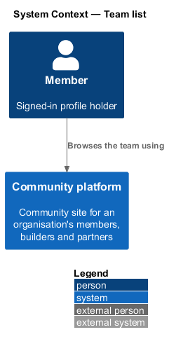
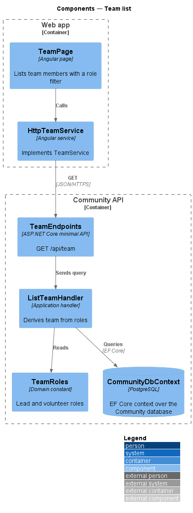
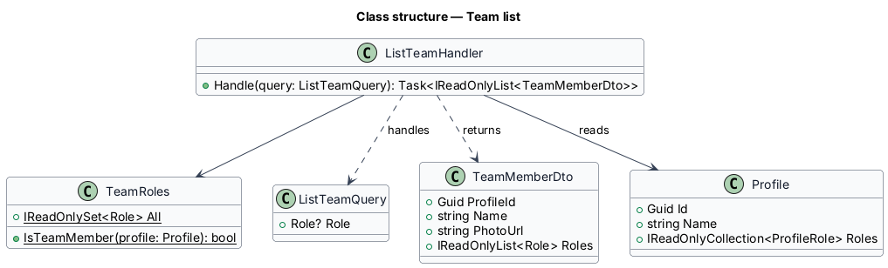
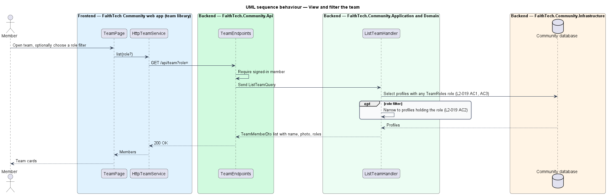

# Team list

## Overview

The **team** — everyone in FaithTech Community who holds a lead role (City Lead, Event Lead, Create Lead or Communications Lead) or the Volunteer role. Team membership is derived from roles, not stored separately: a profile joins the team when it gains one of those roles and leaves when it loses the last one.

The team page lets any signed-in member see who the team is, with name, photo and roles, and filter by role. The `team-board` mock is a separate Agile workspace screen and is outside this slice.

## Description

- **`TeamPage`** — page in the `team` feature library. It lists team members as cards with avatar (featured photo), name and role badges, and offers a role filter.
- **`TeamService`** / **`TEAM_SERVICE`** / **`HttpTeamService`** — API client calling `GET /api/team?role=`.
- **`TeamEndpoints`** — minimal API mapping requiring an authenticated caller.
- **`ListTeamQuery`** (`Role?`) and **`ListTeamHandler`** in Application `Team/`. The handler selects profiles whose roles intersect `TeamRoles`, optionally narrowed to the filtered role.
- **`TeamRoles`** — Domain constant set: City Lead, Event Lead, Create Lead, Communications Lead, Volunteer. `TeamRoles.IsTeamMember(profile)` is true while the profile holds one of them; the Agile workspace membership rule reuses it.
- **`TeamMemberDto`** — `ProfileId`, `Name`, `PhotoUrl`, `Roles`.

Sort order and paging of the team list: `<TO SUPPLY>`.

## Requirements

The feature realizes the following level-2 (L2) requirements. Each L2 requirement refines a level-1 (L1) requirement, cited by identifier.

| L2 ID | Refines (L1) | Requirement |
|-------|--------------|-------------|
| `L2-019` | `L1-007` | Team list |

### Acceptance criteria

**`L2-019` — Team list**

1. Given any signed-in member, when they open the team page, then it lists every profile holding a lead or volunteer role, with name, photo and roles.
2. Given a role filter (Leads or Volunteers) or a city filter, when it is applied, then only matching team members are listed.
3. Given a profile that loses its last lead or volunteer role, when the team page is viewed, then that profile no longer appears.

## Diagrams

### System context

Any signed-in member views the team. No external system takes part; anonymous visitors cannot see profiles (`L2-005`).

### Containers

The `team` feature library in the Angular web app calls the Community API over HTTPS with an OAuth2 bearer token. The API persists state in the PostgreSQL Community database.

### Components

`ListTeamHandler` derives membership from `TeamRoles` on every request, so role changes take effect at once.

### Class structure

`ListTeamHandler` reads `Profile` roles against `TeamRoles` and returns `TeamMemberDto` items.

### Behaviour — view and filter the team

Membership is computed from current roles, so a profile that loses its last team role drops out on the next view (`L2-019` AC3).

## Open questions

Decisions recorded while building the Domain layer (`FaithTech.Community.Domain`):

- Team membership stays derived from roles through `TeamRoles.IsTeamMember`; nothing is stored. Resolved.
